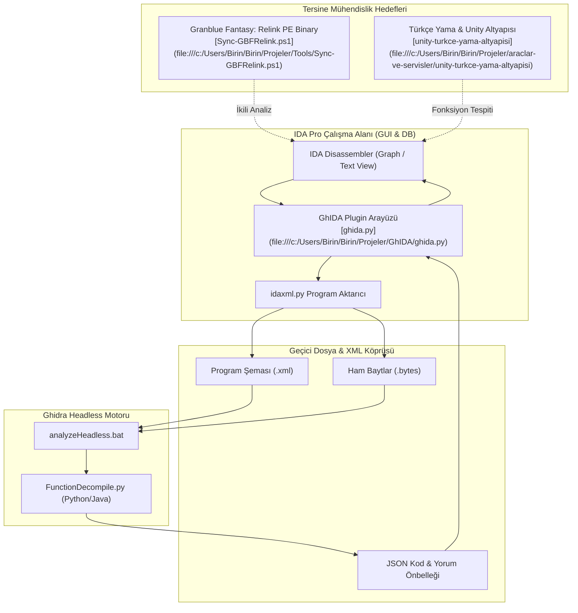

# 🔬 GhIDA - Ghidra Decompiler for IDA Pro & Tersine Mühendislik Araçları

IDA Pro disassembler ortamına Ulusal Güvenlik Ajansı'nın (NSA) açık kaynaklı **Ghidra** decompiler motorunu entegre eden; **Granblue Fantasy: Relink** PE ikili dosya analizi, Unity/C++ oyun lokalizasyonu ve Türkçe yama tersine mühendisliği için optimize edilmiş gelişmiş analiz köprüsü.

---

## 🎯 1. Projenin Amacı ve Kapsamı

GhIDA, pahalı Hex-Rays decompiler lisansına ihtiyaç duymaksızın IDA Pro içerisinde yüksek doğruluklu C/C++ sahte kod (pseudocode) üretmek amacıyla geliştirilmiş açık kaynaklı bir eklentidir.

Bu çalışma alanında GhIDA; yalnızca genel ikili dosya (PE/ELF x86/x64) analizi için değil, aynı zamanda:
1. **Granblue Fantasy: Relink İkili Analizi:** Oyun motoru fonksiyonlarının, dosya paketleme yapılarının ve veri tablolarının analizi (`Tools/Sync-GBFRelink.ps1`).
2. **Türkçe Yama & Lokalizasyon Mühendisliği:** Unity ve C++ tabanlı oyunların metin şifreleme ve font motorlarını tersine mühendislikle çözümleme (`unity-turkce-yama-altyapisi`).
3. **Otomasyon & Kurulum Araçları:** IDA Pro ve Ghidra ortamını otomatik algılayan, yapılandıran ve kuran PowerShell otomasyonu (`install_ghida.ps1`) ve sağlık denetleyicisi (`check_ghida_env.py`).

---

## 🚀 2. Temel Özellikler

- **Ghidra Decompiler Entegrasyonu:** IDA Pro içerisinde herhangi bir fonksiyona tıklandığında `Ctrl + Alt + D` ile Ghidra'yı arka planda headless modda çağırarak anında decompile etme.
- **Çift Yönlü Görünüm Senkronizasyonu (View Sync):** IDA'nın Assembly/Graph görünümü ile GhIDA decompiler penceresinin imleç hareketlerine göre eşzamanlı güncellenmesi.
- **Sözdizimi Vurgulama (Syntax Highlighting):** Python `pygments` kütüphanesiyle decompile edilen C kodunun renklendirilmesi.
- **İnteraktif Sembol Gezintisi & Yeniden Adlandırma (Renaming):**
  - Fonksiyon adlarına çift tıklayarak kod içinde zıplama.
  - `N` tuşu ile decompiler üzerinden sembol adı değiştirildiğinde IDA'nın veritabanına otomatik yansıtılması.
- **Kalıcı Yorum ve Kod Önbelleği (Caching):**
  - Fonksiyon satırlarına `:` tuşu ile `//` şeklinde kalıcı yorumlar ekleyebilme.
  - Decompile edilen kodların JSON formatında geçici belleğe alınarak tekrar çağrıldığında 0ms sürede açılması.
- **Otomatik Ortam & Kurulum Denetimi (`check_ghida_env.py`):**
  - IDA Pro sürümü, Python 3 çalışma zamanı, `requests`, `pygments` paketleri ve Ghidra kurulum yolunun otomatik teşhisi.
- **Sessiz PowerShell Kurulum Sihirbazı (`install_ghida.ps1`):**
  - IDA Pro eklentiler klasörünü bulup `ghida.py` ve `ghida_plugin` paketini tek komutla kurma/kaldırma.

---

## 🏗️ 3. Mimari & Teknoloji Yığını (Stack)

### 3.1. İletişim ve Ayrıştırma Mimarisi



### 3.2. Teknoloji Bileşenleri

| Bileşen | Teknoloji | Sürüm | Görev |
| :--- | :--- | :--- | :--- |
| **Disassembler** | Hex-Rays IDA Pro | 7.4 - 8.x / 9.x | Temel statik analiz, akış diyagramı (CFG) |
| **Decompiler Motoru**| NSA Ghidra (Ghidra SRE) | 9.1.2 - 10.4+ | Başsız C decompiler ve tip çözümleyici |
| **Eklenti Dili** | Python 3 (IDAPython) | 3.8+ | IDA SDK ile etkileşim, UI pencereleri ve soket köprüsü |
| **Sözdizimi Renklendirme**| Pygments | 2.x | Decompile edilen C kodunun token renklendirmesi |
| **Otomasyon Scripti**| PowerShell 5.1 / 7+ | Core | İmzalı kurulum ve dizin yapılandırma sihirbazı |

---

## 🗺️ 4. Proje Bilgi Grafiği & Sembol Haritası (Graphify / Yapı)

### 4.1. Dizin ve Dosya Haritası

```
GhIDA/
├── ghida.py                          # IDA Pro ana eklenti giriş noktası
├── check_ghida_env.py                # Ortam ve bağımlılık doğrulayıcı script
├── install_ghida.ps1                 # İmzalı tek tıkla eklenti kurulum betiği
├── README.md                         # Bu dokümantasyon
├── LICENSE                           # Apache License 2.0
├── ghida_plugin/                     # Çekirdek Eklenti Kütüphaneleri
│   ├── __init__.py
│   ├── config.py                     # Geçici dizin ve yapılandırma JSON yöneticisi
│   ├── decompiler.py                 # Ghidra çağırma ve süreç yöneticisi
│   ├── form.py                       # Decompiler arayüz penceresi (QTree/QText)
│   ├── lib.py                        # Sabitler (TIMEOUT, bellek limitleri)
│   ├── utility.py                    # Ghidra-IDA sembol ve ad syntax çevirici
│   └── ghidra_plugin/
│       └── FunctionDecompile.py      # Ghidra headless içinde çalışan decompile scripti
│
├── Tools/                            # İlişkili Oyun Tersine Mühendislik Araçları
│   ├── Sync-GBFRelink.ps1            # Granblue Fantasy: Relink dosya senkronizasyonu
│   ├── Kopyala-EksikGBFR.ps1         # Eksik oyun bileşenlerini tamamlama aracı
│   └── Kopyala-EksikGBFR.bat         # Hızlı Windows başlatıcısı
│
└── araclar-ve-servisler/unity-turkce-yama-altyapisi/ # Oyun Lokalizasyon Modülü
    ├── nemurimouto/                  # Örnek görsel roman tersine mühendislik çıktısı
    ├── factorial-omega/              # Unity varlık ayrıştırıcı
    └── YAMA_REHBERI_VE_TEKNIK_ANALIZ.md # Hex düzenleme ve string tablosu rehberi
```

### 4.2. Temel Semboller ve Dosya Bağlantıları

- [`GhIDA_Plugin`](file:///c:/Users/Birin/Birin/Projeler/GhIDA/ghida.py): `ida_idaapi.plugin_t` arayüzünü uygulayan ve IDA Pro başlatıldığında menülere ve kısayollara bağlanan ana sınıf.
- [`GhidaEnvironmentChecker`](file:///c:/Users/Birin/Birin/Projeler/GhIDA/check_ghida_env.py): IDAPython ortamını, Ghidra `analyzeHeadless.bat` varlığını ve Python kütüphanelerini denetleyen teşhis aracı.
- [`InstallGhidaScript`](file:///c:/Users/Birin/Birin/Projeler/GhIDA/install_ghida.ps1): IDA kurulum yolunu otomatik tespit edip eklentiyi yerleştiren imzalı PowerShell scripti.
- [`DecompilerCore`](file:///c:/Users/Birin/Birin/Projeler/GhIDA/ghida_plugin/decompiler.py): IDA verilerini `idaxml` ile dışa aktaran ve Ghidra headless sürecini yürüten modül.
- [`SyncGBFRelink`](file:///c:/Users/Birin/Birin/Projeler/Tools/Sync-GBFRelink.ps1): Granblue Fantasy: Relink oyun dosyalarını hash doğrulamasıyla senkronize eden araç.

---

## 🤖 5. İlgili Agent Becerileri (Skills) ve Kuralları

Bu araçlarla ikili dosya analizi ve tersine mühendislik yürütecek yapay zeka ajanları aşağıdaki prensiplere uymalıdır:

### 5.1. Zorunlu Beceriler (Skills)
- **`cpp-coding-standards`**: Decompile edilen C/C++ kodlarını analiz ederken bellek hizalamaları, sanal metot tabloları (vtable) ve çağrı kurallarına (`__fastcall`, `__cdecl`) dikkat et.
- **`targeted-error-locator`**: Headless Ghidra çalıştırılırken `TIMEOUT` veya XML aktarım hataları oluşursa, hatayı `ghida_plugin/lib.py` ve `idaxml.py` parametrelerinde cerrahi olarak izole et.
- **`subagent-token-sentinel`**: 1000+ satırlık decompile edilmiş pseudocode çıktılarında fonksiyon başlangıç ve bitiş aralıklarını dilimleyerek oku.

### 5.2. Ajan Geliştirme Yönergeleri
1. **Veritabanı Rebase Uyarısı:** Eğer taranan ikili dosya IDA içinde rebase edilirse (farklı temel adrese taşınırsa), GhIDA önbelleği (`Clear cache for current function`) mutlaka temizlenmelidir.
2. **Karakter Kodlama Bütünlüğü:** Granblue Fantasy: Relink ve Türkçe yama ayrıştırmalarında UTF-8 ve Windows-1254 karakter tablolarının birbirine karışması önlenmelidir.
3. **Authenticode İmzası:** Değiştirilen veya eklenen tüm PowerShell scriptleri (`.ps1`) çalışma alanının standart Authenticode sertifikası ile imzalanmalıdır.

---

## ⚙️ 6. Kurulum ve Çalıştırma Talimatları

### 6.1. Ortamın Doğrulanması

```powershell
cd "c:\Users\Birin\Birin\Projeler\GhIDA"
python check_ghida_env.py
```

### 6.2. Otomatik Eklenti Kurulumu

```powershell
# Etkileşimli kurulum sihirbazını başlatın
.\install_ghida.ps1

# Veya IDA ve Ghidra yollarını doğrudan belirterek sessiz kurun:
.\install_ghida.ps1 -IdaPath "C:\Program Files\IDA Pro 8.3" -GhidraPath "C:\tools\ghidra_10.4_PUBLIC"
```

### 6.3. IDA Pro İçinde Kullanım
1. IDA Pro'yu açın ve analiz edilecek PE/ELF ikili dosyasını yükleyin.
2. Decompile etmek istediğiniz bir fonksiyonun üzerine gelin.
3. **`Ctrl + Alt + D`** tuşlarına basın veya sağ tıklayıp **"Decompile function with GhIDA"** seçeneğini seçin.
4. Açılan pencerede renklendirilmiş C kodunu inceleyin, `N` ile sembolleri yeniden adlandırın veya `:` ile açıklama satırları ekleyin.

### 6.4. Granblue Fantasy: Relink Senkronizasyonunu Çalıştırma

```powershell
cd "c:\Users\Birin\Birin\Projeler\Tools"
# Önizleme modunda eksik dosyaları denetle
.\Sync-GBFRelink.ps1 -WhatIf

# Hash doğrulamalı tam senkronizasyon yap
.\Sync-GBFRelink.ps1 -Verify
```
