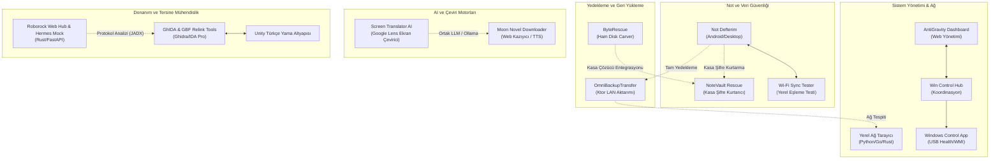

# 🌌 Antigravity Projeler Monorepo & Multi-Agent Orchestration Hub

> [!CRITICAL]
> # ⚠️ TÜM YAPAY ZEKA AJANLARININ (AI AGENTS) DİKKATİNE:
> 
> **BU DEPO SADECE MERKEZİ DEPOLAMA, YEDEKLEME VE ORKESTRASYON AMACIYLA KULLANILMAKTADIR.**
> 
> 1. **`main` DALI ÜZERİNDE KESİNLİKLE DOĞRUDAN UYGULAMA GELİŞTİRİLEMEZ VEYA KODLAMA YAPILAMAZ.**
> 2. **HER BİR UYGULAMA, SERVİS VEYA PROJE İÇİN KESİNLİKLE FARKLI VE BAĞIMSIZ BİR BRANCH AÇILMASI ZORUNLUDUR.**
> 3. Bir görev aldığınızda ilk adım olarak ilgili projenin dalına geçiş yapın (`git checkout project/<proje-adi>`) veya yeni bir uygulama/servis geliştiriyorsanız yeni bir branch oluşturun (`git checkout -b project/<yeni-uygulama>`).
> 4. `main` dalı sadece;
>    - Merkezi orkestrasyon hafızasını (`PROJECT_STATE.md`),
>    - Küresel proje indeksini ve yönlendirme haritasını,
>    - ECC kurallarını ve uzmanlık becerilerini (`.agents/`),
>    - Tüm projelerin üst düzey Graphify bilgi grafiğini (`graphify-out/`) barındırır.
> 5. İlgili branch üzerinde yapılan her geliştirme, testler tamamlandıktan sonra kendi branch'ine commit edilmeli ve GitHub'a (`git push origin <branch>`) push edilmelidir.

---

Tüm masaüstü, mobil, sistem yönetimi, veri kurtarma, yapay zeka ve tersine mühendislik projelerinin merkezi monorepo deposu, dizin rehberi, Git şube (branch) haritası ve yapay zeka ajanları (multi-agent) orkestrasyon manifestosu.

---

## 🎯 1. Monoreponun Amacı ve Kapsamı

`c:\Users\Birin\Birin\Projeler` monoreposu; birbirinden bağımsız gibi görünen ancak ortak bir mimari felsefe (sıfır bulut bağımlılığı, yerel öncelikli güvenlik, yüksek performans, modern koyu ve cam morfizm temalar) etrafında birleşen 10+ projeyi tek bir çatı altında toplamaktadır.

Monorepo; Android mobil uygulamalarından (Kotlin/Java), masaüstü yüksek başarımlı mikroservislerine (Rust/Go), veri kurtarma ve tersine mühendislik araçlarına (Electron/Ghidra/IDA) kadar geniş bir teknoloji yelpazesini barındırır. Yapay zeka ajanlarının bu depoya atandığında sıfır oryantasyon süresiyle doğrudan doğru dizine, doğru araca ve doğru test mekanizmasına ulaşabilmesi için standartlaştırılmıştır.

---

## 🚀 2. Proje Portföyü ve Temel Özellikler Özeti

| Kategori | Proje | Temel Teknoloji | Özet ve Yetenekler |
| :--- | :--- | :--- | :--- |
| **Not Uygulamaları** | [`not-defterim`](file:///c:/Users/Birin/Birin/Projeler/not-uygulamalari/not-defterim) | Android Compose + Rust/Go Masaüstü | Sıfır-bilgi (AES-GCM 256) şifreli, Wi-Fi LAN senkronizasyonlu zengin not alma ekosistemi. |
| **Not Uygulamaları** | [`note-vault-rescue`](file:///c:/Users/Birin/Birin/Projeler/not-uygulamalari/note-vault-rescue) | Python 3, PyCryptodome, Flask | Unutulmuş `.notevault` kasalarını saniyede 1M+ şifre deneyerek kurtaran mutasyon motoru. |
| **Yedekleme & Kurtarma** | [`byte-rescue`](file:///c:/Users/Birin/Birin/Projeler/yedekleme-kurtarma/byte-rescue) | Electron 33, Svelte 5, Node.js | Formatlanmış disklerden 64 KB kayan pencere ile bayt düzeyinde dosya kurtaran siber radar aracı. |
| **Yedekleme & Kurtarma** | [`omni-backup-transfer`](file:///c:/Users/Birin/Birin/Projeler/yedekleme-kurtarma/omni-backup-transfer) | Android Kotlin, Ktor CIO Server | İnternetsiz Wi-Fi LAN üzerinden canlı zip akışıyla telefon depolaması ve WhatsApp yedekleme sihirbazı. |
| **Araçlar & Servisler** | [`yerel-ag-tarayici`](file:///c:/Users/Birin/Birin/Projeler/araclar-ve-servisler/yerel-ag-tarayici) | Python Tkinter, Go, Rust | Donanım seviyesinde Windows SendARP çağrılı çok dilli yerel ağ keşif ve port teşhis ekosistemi. |
| **Araçlar & Servisler** | [`screen-translator`](file:///c:/Users/Birin/Birin/Projeler/araclar-ve-servisler/screen-translator) | PyQt5, WinRT OCR, Gemini/Ollama | Google Lens stili kaydırmalı perde ile ekrandaki oyun ve metinleri yerinde gerçek zamanlı çeviren motor. |
| **Araçlar & Servisler** | [`moon-novel-downloader`](file:///c:/Users/Birin/Birin/Projeler/araclar-ve-servisler/moon-novel-downloader) | Android Kotlin, Jsoup, TTS | Web romanları (NovelBin vb.) reklamsız kazıyan, Türkçeleştiren, çevrimdışı arşivleyen ve seslendiren uygulama. |
| **Araçlar & Servisler** | [`c-pe-builder`](file:///c:/Users/Birin/Birin/Projeler/araclar-ve-servisler/c-pe-builder) | C/C++, MSVC, Windows SDK | Bağımsız Windows Portable Executable (PE) derleme ve kaynak enjeksiyon aracı. |
| **Araçlar & Servisler** | [`unity-turkce-yama-altyapisi`](file:///c:/Users/Birin/Birin/Projeler/araclar-ve-servisler/unity-turkce-yama-altyapisi) | Python, Binary Patcher | Unity motorlu oyunların dil dosyalarını, fontlarını ve varlıklarını deşifre eden yama altyapısı. |
| **Sistem Yönetimi** | [`antigravity-dashboard`](file:///c:/Users/Birin/Birin/Projeler/sistem-yonetimi/antigravity-dashboard) | Flask, HTML5 Cam Morfizm, GDrive | Bilgisayar telemetrisi izleme, disk çöpü temizleme, güç zamanlayıcı ve 5 TB Google Drive yöneticisi. |
| **Sistem Yönetimi** | [`win-control-hub`](file:///c:/Users/Birin/Birin/Projeler/sistem-yonetimi/win-control-hub) | Windows Batch, Python Venv | Tüm yönetim ve donanım denetim servislerini başlatan merkezi konsol. |
| **Sistem Yönetimi** | [`windows-control-app`](file:///c:/Users/Birin/Birin/Projeler/sistem-yonetimi/windows-control-app) | Python WMI, Subprocess, Hermes | USB bellek sağlık kontrolü (`chkdsk`/sektör testi) ve otonom sistem yöneticisi. |
| **Robot Kontrol** | [`rrcc-master`](file:///c:/Users/Birin/Birin/Projeler/rrcc-master) | Rust Tokio, FastAPI, Three.js | Roborock Q8 Max Pro Web Hub kontrol paneli ve resmi APK v4.74.08 Hermes v96 RPC Mock Sunucusu. |
| **Tersine Mühendislik** | [`GhIDA`](file:///c:/Users/Birin/Birin/Projeler/GhIDA) & [`Tools`](file:///c:/Users/Birin/Birin/Projeler/Tools) | IDA Pro, Python 3, Ghidra SRE | NSA Ghidra decompiler'ını IDA Pro'ya entegre eden köprü ve Granblue Fantasy: Relink PE analiz araçları. |

---

## 🏗️ 3. Monorepo Mimarisi & Dizin Ağacı

```
c:\Users\Birin\Birin\Projeler/
├── README.md                         # Bu ana monorepo rehberi ve orkestrasyon kılavuzu
├── PROJELER_REHBERI.md               # Detaylı mimari dönüşüm ve geçiş manifestosu
├── WORKSPACE.md                      # Antigravity çalışma alanı yönergeleri
├── GEMINI.md                         # Antigravity temel kuralları ve ilkeleri
│
├── baslaticilar/                     # Merkezi Windows Yönetim Konsolları
│   └── PROJELERI_BASLAT.bat          # Tek tıkla interaktif tüm projeleri başlatma menüsü
│
├── not-uygulamalari/                 # Not ve Kasa Ekosistemi
│   ├── not-defterim/                 # Android + Rust/Go Masaüstü Hibrit Not Defterim
│   └── note-vault-rescue/            # Unutulmuş .notevault Kasa Şifresi Çözme Motoru
│
├── yedekleme-kurtarma/               # Veri Kurtarma ve Yerel Aktarım
│   ├── byte-rescue/                  # Electron + Svelte 5 Ham Sektör Dosya Kurtarıcı
│   └── omni-backup-transfer/         # Android Ktor LAN WhatsApp & Depolama Aktarıcı
│
├── araclar-ve-servisler/             # Çok Amaçlı Araçlar ve Mikroservisler
│   ├── yerel-ag-tarayici/            # Python Tkinter Ağ Keşif & Port Tarayıcı
│   ├── yerel-ag-tarayici-go/         # Go Windows SendARP Hızlı Tarama Motoru
│   ├── yerel-ag-tarayici-rust/       # Rust Rayon Paralel Mikroservis
│   ├── screen-translator/            # Google Lens Stili Anlık Ekran Çevirici
│   ├── moon-novel-downloader/        # Web Roman Kazıyıcı, Çevirici ve TTS Okuyucu
│   ├── c-pe-builder/                 # Windows C/C++ PE İkili Derleyici
│   ├── unity-turkce-yama-altyapisi/  # Unity Oyun Lokalizasyon ve Yama Araçları
│   └── wifi-sync-tester/             # Node.js Wi-Fi Senkronizasyon Test Tezgahı
│
├── sistem-yonetimi/                  # Windows Sistem Yönetimi ve Dashboard
│   ├── antigravity-dashboard/        # Cam Morfizm Web Kontrol Paneli (Port 5000)
│   ├── win-control-hub/              # Python Ortamı ve Servis Koordinasyon Konsolu
│   └── windows-control-app/          # WMI USB Sağlık Denetçisi & Hermes Yürütücü
│
├── rrcc-master/                      # Roborock Robot Süpürge Ekosistemi
│   ├── roborock_mock_server/         # Rust Hermes v96 RPC Mock Sunucusu (:54321, :58867)
│   ├── web_hub/                      # FastAPI & Three.js 3D Web Kontrol Paneli (:8000)
│   └── rrcc.exe                      # Klasik Qt C++ Kontrol Merkezi
│
├── GhIDA/                            # Ghidra Decompiler for IDA Pro
│   ├── ghida.py                      # IDAPython eklenti köprüsü
│   ├── install_ghida.ps1             # İmzalı otomatik kurulum betiği
│   └── check_ghida_env.py            # Ortam doğrulama modülü
│
├── Tools/                            # Oyun & İkili Dosya Senkronizasyon Betikleri
│   ├── Sync-GBFRelink.ps1            # Granblue Fantasy: Relink dosya senkronizasyonu
│   └── Kopyala-EksikGBFR.ps1         # Eksik oyun dosyalarını tamamlama aracı
│
└── .agents/                          # Ajan Becerileri, İş Akışları ve Kurallar Kütüphanesi
    ├── agents/                       # Uzmanlaşmış ajan tanımları
    ├── rules/                        # Proje çapında koruma kuralları
    ├── skills/                       # 100+ teknik beceri kütüphanesi
    └── workflows/                    # Otonom sprint ve denetim iş akışları
```

---

## 🗺️ 4. Bilgi Grafiği (Graphify) ve Projeler Arası Entegrasyon



---

## 🌿 5. Git Şube (Branch) Yapısı ve Yönetimi

Monorepo, aşağıdaki aktif ve korumalı dallar üzerinden sürdürülmektedir:

| Dal (Branch) Adı | Kapsam ve Sorumluluk | İlgili Dizinler |
| :--- | :--- | :--- |
| **`main`** | Kararlı, doğrulanmış ve tüm testleri geçmiş üretim kodu. | Tüm Monorepo |
| **`kadiraydin321-not-defterim-ui-refresh`** | Not Defterim v2.0 UI yenilemesi, masaüstü hibrit entegrasyonu, zengin metin araç çubuğu ve takvim gruplaması. | `not-uygulamalari/not-defterim` |
| **`kadiraydin321-fdm-link-aktarimi`** | Free Download Manager (FDM) bağlantı yakalama, dış indirme bağlantılarını yönlendirme köprüleri. | `araclar-ve-servisler/` |
| **`kadiraydin321-turkish-patch-manager`** | Oyun tersine mühendisliği, Granblue Relink senkronizasyonu, REA CLI ve GhIDA araçları entegrasyonu. | `GhIDA/`, `Tools/`, `unity-turkce-yama-altyapisi/` |

---

## 🤖 6. Ajan (Multi-Agent) Orkestrasyon Rehberi ve Kuralları

Bu monorepoya atanan herhangi bir yapay zeka ajanı, sıfır oryantasyon süresiyle çalışabilmek için aşağıdaki temel ilkeleri benimsemelidir:

### 6.1. Öncelikli Ajan Becerileri (Skills Matrisi)
- **`subagent-token-sentinel` (ZORUNLU):** 100+ satırlık dosyaları tek parça okumak kesinlikle YASAKTIR. Önce `Select-String` veya `grep` ile hedef satır numarasını bul, ardından `StartLine` ve `EndLine` ile cerrahi dilimle.
- **`targeted-error-locator`:** Derleme, test veya çalışma zamanı hatalarında tüm dosyayı yeniden yazmak yerine, hatanın kaynaklandığı satırı cerrahi olarak izole et ve yalnızca gerekli bloğu düzenle (`edit_file`).
- **`codebase-design`:** Yeni bir modül veya servis eklerken monoreponun gevşek bağlı (loosely coupled) mimarisine sadık kal; dairesel bağımlılıklar (circular dependency) oluşturma.
- **`rust-patterns` & `golang-patterns`:** Sistem seviyesi servislerde (`yerel-ag-tarayici-rust`, `yerel-ag-tarayici-go`, `roborock_mock_server`) eşzamanlılık (concurrency) ve bellek güvenliği kurallarını uygula.
- **`android-clean-architecture` & `kotlin-coroutines-flows`:** Android projelerinde (`not-defterim`, `omni-backup-transfer`, `moon-novel-downloader`) UI katmanını saf tut, G/Ç işlerini her zaman `Dispatchers.IO` ile yönet.
- **`liquid-glass-design`:** Web arayüzlerinde (`antigravity-dashboard`, `rrcc-master/web_hub`) cam morfizm neon karanlık tema uyumunu koru.

### 6.2. Güvenlik ve Bütünlük Kuralları
1. **PowerShell Betik İmzası:** Monorepoda üretilen veya güncellenen tüm PowerShell scriptleri (`.ps1`), projenin geçerli Authenticode sertifikası ile imzalanmalıdır (`Thumbprint: 18BDDE60A34E2F5E2AF49A9420F71C55445DE6F4`).
2. **Korumalı Veritabanları:** `.notdefterim/notes_desktop.db` ve kullanıcı şifreli kasaları doğrudan değiştirilemez; işlemler yalnızca uygulamanın resmi API veya göç (migration) motoru üzerinden yapılmalıdır.
3. **API Anahtarları ve Hassas Veriler:** `.env`, `credentials.json`, `token.pickle` veya özel anahtarlar kesinlikle Git'e pushlanamaz; her dizinin `.gitignore` dosyası kontrol edilmelidir.

---

## ⚙️ 7. Genel Kurulum ve Çalıştırma Talimatları

### 7.1. Merkezi Başlatıcı Konsolu (Tavsiye Edilen)

Tüm projeleri, dashboard'ları ve test sunucularını tek bir renkli arayüzden yönetmek için:

```powershell
cd "c:\Users\Birin\Birin\Projeler\baslaticilar"
.\PROJELERI_BASLAT.bat
```

### 7.2. Hızlı Proje Başlatma Referans Tablosu

```powershell
# 1. Yerel Ağ Tarayıcı (Python GUI)
cd "c:\Users\Birin\Birin\Projeler\araclar-ve-servisler\yerel-ag-tarayici"; python main.py

# 2. ByteRescue Veri Kurtarma (Electron + Svelte)
cd "c:\Users\Birin\Birin\Projeler\yedekleme-kurtarma\byte-rescue"; .\Baslat_ByteRescue.bat

# 3. OmniBackupTransfer (Android Ktor LAN)
cd "c:\Users\Birin\Birin\Projeler\yedekleme-kurtarma\omni-backup-transfer"; .\Baslat_OmniBackupTransfer.bat

# 4. Screen Translator AI (Ekran Çevirici)
cd "c:\Users\Birin\Birin\Projeler\araclar-ve-servisler\screen-translator"; .\Baslat_ScreenTranslator.bat

# 5. Moon Novel Downloader (Web Roman Kazıyıcı)
cd "c:\Users\Birin\Birin\Projeler\araclar-ve-servisler\moon-novel-downloader"; .\Baslat_MoonNovelDownloader.bat

# 6. Roborock Hermes v96 Mock Server (Rust)
cd "c:\Users\Birin\Birin\Projeler\rrcc-master"; .\Baslat_Mock_Server.ps1

# 7. AntiGravity PC Dashboard (Port 5000)
cd "c:\Users\Birin\Birin\Projeler\sistem-yonetimi\antigravity-dashboard"; .\Baslat_AntiGravity.bat

# 8. GhIDA IDA Pro Entegrasyonu
cd "c:\Users\Birin\Birin\Projeler\GhIDA"; .\install_ghida.ps1
```
