# 🌙 Moon Novel Downloader & Reader (Web Roman Kazıyıcı, Çevirici ve Akıcı TTS Okuyucu)

Çok kaynaklı popüler web romanlarını (Light Novel, Web Novel, Wuxia, Xianxia) doğrudan internetten kazıyan (scraper), yapay zeka ile Türkçeleştiren, çevrimdışı arşivleyen (EPUB/TXT) ve gelişmiş metinden-sese (TTS) teknolojisiyle sesli kitaba dönüştüren modern Android ekosistemi.

---

## 🎯 1. Projenin Amacı ve Kapsamı

Moon Novel Downloader; yabancı ve yerli web roman platformlarındaki binlerce bölümlük serileri tek tek kopyalama derdini ortadan kaldıran, reklam ve takipçileri filtreleyen (AdGuard DoH DNS), bölümleri arka planda toplu olarak indirip yerel veritabanında saklayan ve kullanıcılara konforlu bir okuma/dinleme deneyimi sunan çok modüllü bir Android uygulamasıdır.

Proje aynı zamanda **5 Kademeli Otonom Çoklu-Ajan (Multi-Agent)** iş akışı (`MULTI_AGENT_WORKFLOW.md`) ve yerel LLM (`qwen3-coder:30b` / Ollama) entegrasyonuyla geliştirilmektedir.

---

## 🚀 2. Temel Özellikler

- **Çoklu Kaynak Kazıma (Multi-Source Scraper):**
  - **NovelBin (`NovelBinAdapter`):** Dünyanın en geniş İngilizce web roman arşivinden bölüm listesi ve temiz metin çıkarma.
  - **NovelGecesi (`NovelGecesiAdapter`):** Popüler Türkçe web roman ve çeviri platformu desteği.
  - **WuxiaWorld EN (`WuxiaWorldEnAdapter`):** Doğu Asya dövüş sanatları ve Xianxia külliyatı adaptörü.
- **Akıllı Metin Ayrıştırma & Reklam Filtreleme (`AdGuardDohDns`):**
  - Bölüm metinlerinin içine gizlenmiş reklam, yönlendirme ve filigran satırlarını temizleme.
  - DNS-over-HTTPS (DoH) ile İSS seviyesindeki web engellerini aşma.
- **Dahili Yapay Zeka Çeviri Motoru (`TranslationEngine`):** İngilizce bölümleri Google Gemini Flash, Google Translate veya yerel modeller aracılığıyla bağlamı koruyarak Türkçeleştirme ve yerel önbelleğe alma.
- **Cümle Vurgulu Akıcı TTS (`TtsVoiceHelper`):**
  - Android yerel metinden-sese motoru entegrasyonu.
  - Noktalama işaretlerine göre doğal duraklama (nefes payı) ve kısaltmaları (Dr., Mr., vb.) doğru telaffuz etme.
  - Okunan cümlenin ekranda otomatik parlama (highlight) ile takip edilmesi.
- **Gelişmiş Okuyucu Arayüzü (`ReaderActivity`):**
  - Gece modu, sepya, AMOLED saf siyah ve özel kağıt dokusu temaları (`AppThemeManager`).
  - Satır aralığı, kenar boşluğu, yazı tipi boyutu ve otomatik kaydırma seçenekleri.
- **Okuma İstatistikleri & Yedekleme:**
  - Günlük/haftalık okuma süresi, kelime sayısı ve sayfa takibi (`ReadingStatsManager`).
  - Okuma geçmişi ve indirilen romanların tek tıkla dışa aktarımı (`BackupRestoreManager`).
- **Otomatik Güncelleme (OTA):** GitHub Releases üzerinden yeni sürümleri algılayıp uygulama içinden güncelleme (`AppUpdateManager`).

---

## 🏗️ 3. Mimari & Teknoloji Yığını (Stack)

### 3.1. Çoklu-Ajan (Multi-Agent) Geliştirme ve Çalışma Mimarisi

```mermaid
graph TD
    subgraph MultiAgent_Fleet["Otonom Geliştirme Filosu (MULTI_AGENT_WORKFLOW)"]
        Orch["Ana Orkestratör<br/>(Antigravity)"]
        Research["1. Araştırma Ajanı<br/>(Kaynak & Algoritma)"]
        OllamaCoder["2. Ollama Coder<br/>(qwen3-coder:30b)"]
        Coord["3. Koordinatör Ajan<br/>(Backlog & Tracker)"]
        Tester["4. Test & Doğrulama<br/>(Gradle & APK)"]
        Reviewer["5. Denetim Ajanı<br/>(Prompt & Güvenlik)"]

        Orch --> Research
        Orch --> Coord
        Research --> Reviewer
        Reviewer --> OllamaCoder
        OllamaCoder --> Tester
        Tester --> Coord
    end

    subgraph Android_Core["Android Uygulama Mimarisi"]
        UI["Okuyucu & Liste UI<br/>[ReaderActivity.kt](file:///c:/Users/Birin/Birin/Projeler/araclar-ve-servisler/moon-novel-downloader/app/src/main/java/com/birin/moonnovel/reader/ReaderActivity.kt)"]
        Scraper["Kaynak Adaptörleri<br/>[NovelBinAdapter.kt](file:///c:/Users/Birin/Birin/Projeler/araclar-ve-servisler/moon-novel-downloader/app/src/main/java/com/birin/moonnovel/sources/NovelBinAdapter.kt)"]
        TTS["Metinden-Sese Motoru<br/>[TtsVoiceHelper.kt](file:///c:/Users/Birin/Birin/Projeler/araclar-ve-servisler/moon-novel-downloader/app/src/main/java/com/birin/moonnovel/tts/TtsVoiceHelper.kt)"]
        Trans["Çeviri Motoru<br/>[TranslationEngine.kt](file:///c:/Users/Birin/Birin/Projeler/araclar-ve-servisler/moon-novel-downloader/app/src/main/java/com/birin/moonnovel/translation/TranslationEngine.kt)"]
        NetClient["Güvenli Ağ İstemcisi<br/>[SecureNetworkClient.kt](file:///c:/Users/Birin/Birin/Projeler/araclar-ve-servisler/moon-novel-downloader/app/src/main/java/com/birin/moonnovel/SecureNetworkClient.kt)"]
    end

    UI --> Scraper
    UI --> TTS
    UI --> Trans
    Scraper --> NetClient
```



### 3.2. Teknoloji Bileşenleri

| Bileşen | Teknoloji | Amaç |
| :--- | :--- | :--- |
| **Platform** | Android SDK (API 26 - 34) | Güncel Android cihazlar ve tabletlerde uyumlu çalışma |
| **Programlama Dili** | Kotlin (1.9+) | Coroutine yapıları, Flow veri akışları, extension fonksiyonlar |
| **HTML Kazıyıcı** | Jsoup & OkHttp 4 | Sayfalardaki DOM yapısını ayrıştırıp temiz içerik çıkarma |
| **Ağ Güvenliği** | AdGuard DNS-over-HTTPS (DoH) | İSS ve ağ filtrelerini aşarak reklamsız ve güvenli veri çekimi |
| **Yapay Zeka Köprüsü** | Python (`scripts/ollama_bridge.py`) | Yerel Ollama Qwen3 modeliyle otonom kod geliştirme |
| **Seslendirme** | Android Native TextToSpeech Engine | Sıfır gecikmeli, çevrimdışı çalışabilen sesli okuma |

---

## 🗺️ 4. Proje Bilgi Grafiği & Sembol Haritası (Graphify / Yapı)

### 4.1. Dizin ve Dosya Yapısı

```
araclar-ve-servisler/moon-novel-downloader/
├── MULTI_AGENT_WORKFLOW.md           # 5 Ajanlı otonom çalışma protokolü
├── AUTONOMOUS_PROGRESS.md            # Canlı geliştirme sprint takipçisi
├── Baslat_MoonNovelDownloader.bat    # Windows hızlı test ve APK yükleyici
├── build.gradle.kts                  # Kök Gradle yapılandırması
├── scripts/
│   ├── ollama_bridge.py              # Ollama Qwen modeliyle kod geliştirme köprüsü
│   └── prompts/                      # Ajan prompt şablonları
└── app/
    ├── build.gradle.kts              # OkHttp, Jsoup, AndroidX bağımlılıkları
    └── src/main/
        ├── AndroidManifest.xml       # İnternet, WAKE_LOCK ve FOREGROUND_SERVICE izinleri
        └── java/com/birin/moonnovel/
            ├── MainActivity.kt       # Roman arama ve kütüphane ana ekranı
            ├── SecureNetworkClient.kt# OkHttp DoH ve Cookie yöneticisi
            ├── AdGuardDohDns.kt      # DNS-over-HTTPS AdGuard resolver
            ├── reader/
            │   └── ReaderActivity.kt # Sayfa, dikey kaydırma ve TTS okuyucu ekranı
            ├── sources/
            │   ├── NovelSourceModels.kt # Roman, Bölüm ve Kaynak veri modelleri
            │   ├── NovelBinAdapter.kt   # NovelBin HTML kazıma adaptörü
            │   ├── NovelGecesiAdapter.kt# NovelGecesi Türkçe kaynak adaptörü
            │   └── WuxiaWorldEnAdapter.kt # WuxiaWorld adaptörü
            ├── tts/
            │   └── TtsVoiceHelper.kt # Cümle cümle TTS oynatıcı ve duraklama kontrolü
            ├── translation/
            │   └── TranslationEngine.kt # Önbellekli bölüm çeviri motoru
            ├── stats/
            │   └── ReadingStatsManager.kt # Okuma sayaçları ve analiz modülü
            ├── theme/
            │   └── AppThemeManager.kt# AMOLED siyah, sepya ve gece modu yöneticisi
            ├── backup/
            │   └── BackupRestoreManager.kt # JSON yedekleme ve geri yükleme
            └── updater/
                └── AppUpdateManager.kt # GitHub Releases OTA güncelleme denetleyicisi
```

### 4.2. Temel Semboller ve Dosya Bağlantıları

- [`MainActivity`](file:///c:/Users/Birin/Birin/Projeler/araclar-ve-servisler/moon-novel-downloader/app/src/main/java/com/birin/moonnovel/MainActivity.kt): Arama çubuğu, kütüphanedeki kayıtlı romanlar ve indirme ilerleme kartlarını sunan başlangıç aktivitesi.
- [`ReaderActivity`](file:///c:/Users/Birin/Birin/Projeler/araclar-ve-servisler/moon-novel-downloader/app/src/main/java/com/birin/moonnovel/reader/ReaderActivity.kt): Metin boyutlandırma, gece modu, TTS başlatma ve bölüm geçişlerini yöneten ana okuma motoru.
- [`NovelBinAdapter`](file:///c:/Users/Birin/Birin/Projeler/araclar-ve-servisler/moon-novel-downloader/app/src/main/java/com/birin/moonnovel/sources/NovelBinAdapter.kt): `novelbin.com` üzerindeki dinamik bölüm listesini ve şifrelenmemiş metin gövdesini çıkaran adaptör.
- [`TtsVoiceHelper`](file:///c:/Users/Birin/Birin/Projeler/araclar-ve-servisler/moon-novel-downloader/app/src/main/java/com/birin/moonnovel/tts/TtsVoiceHelper.kt): Android TextToSpeech servisini dinleyen, cümle sınırlarını belirleyen ve UI ile senkronize konuşan sınıf.
- [`TranslationEngine`](file:///c:/Users/Birin/Birin/Projeler/araclar-ve-servisler/moon-novel-downloader/app/src/main/java/com/birin/moonnovel/translation/TranslationEngine.kt): Çevrilmiş bölümleri yerel diskte saklayarak tekrar kota harcanmasını engelleyen önbellek katmanı.
- [`OllamaBridge`](file:///c:/Users/Birin/Birin/Projeler/araclar-ve-servisler/moon-novel-downloader/scripts/ollama_bridge.py): Çoklu ajan mimarisinde Ollama `qwen3-coder:30b` modeline Kotlin kod ürettiren Python köprüsü.

---

## 🤖 5. İlgili Agent Becerileri (Skills) ve Kuralları

Moon Novel projesinde geliştirme yürütecek yapay zeka ajanları aşağıdaki protokollere uymalıdır:

### 5.1. Zorunlu Beceriler (Skills)
- **`android-clean-architecture`**: Kaynak kazıyıcılar (`NovelSource`) ile arayüz katmanı (`ReaderActivity`) arasına doğrudan bağımlılık kurulamaz. Veri akışı Repository ve Coroutine Dispatchers üzerinden yönetilmelidir.
- **`kotlin-coroutines-flows`**: Web roman indirme işlemlerinde eşzamanlı istek sayısı maksimum 3 ile sınırlandırılmalıdır (`Semaphore(3)`); hedef sunucudan 429 Too Many Requests (Rate Limit) alınması engellenmelidir.
- **`subagent-token-sentinel`**: Çoklu ajan döngüsünde üretilen kod çıktılarını cerrahi satır aralıklarıyla incele.

### 5.2. Ajan Geliştirme Yönergeleri
1. **Kaynak Ayrıştırma Koruması:** Web sitelerinin HTML yapısı değiştiğinde çökmeleri önlemek için Jsoup seçicileri (`select`) her zaman `null-safe` kontrolünden geçmeli ve hata durumunda kullanıcıya açıklayıcı mesaj dönülmelidir.
2. **TTS Bellek Yönetimi:** Yüzlerce sayfalık tek parça metin doğrudan `TextToSpeech.speak` metoduna verilmemeli; cümle veya en fazla 4000 karakterlik parçalar halinde kuyruklanmalıdır.
3. **OTA Güncelleme Bütünlüğü:** `AppUpdateManager` yeni APK indirirken dosya bütünlüğünü (SHA-256) doğrulamadan yükleme niyetini (`ACTION_VIEW`) tetiklememelidir.

---

## ⚙️ 6. Kurulum ve Çalıştırma Talimatları

### 6.1. Gradle ile Derleme ve Yükleme

```powershell
cd "c:\Users\Birin\Birin\Projeler\araclar-ve-servisler\moon-novel-downloader"

# Birim testleri çalıştırma
.\gradlew test

# Release APK derleme
.\gradlew assembleRelease

# Çıktı: app/build/outputs/apk/release/app-release-unsigned.apk
```

### 6.2. Hızlı Windows Başlatıcısı

```powershell
# Cihazı algılayıp APK'yı yükleyen ve logcat ekranı açan hazır script
.\Baslat_MoonNovelDownloader.bat
```

### 6.3. Çoklu-Ajan Kod Üretim Köprüsünü Çalıştırma

```powershell
# Yerel Ollama qwen3 modeline yeni kaynak adaptörü yazdırma
python scripts/ollama_bridge.py --source "novelbin"
```
