# 🔍 Screen Translator AI (Google Lens Stili Anlık Ekran Çevirici)

Ekrandaki yazıları gerçek zamanlı olarak algılayıp yapay zeka modellerine (Google Gemini Flash AI, Ollama, Google Translate) aktaran, kullanıcının okuduğu metnin üzerinde yerinde ve **Google Lens benzeri kaydırmalı (swipe slider)** perde efektiyle gösteren ultra optimize edilmiş anlık ekran çeviri motoru.

---

## 🎯 1. Projenin Amacı ve Kapsamı

Screen Translator AI; yabancı dildeki oyunlar, çizgi romanlar/mangalar, PDF dökümanları, videolar ve masaüstü yazılımlarındaki metinleri kopyalamaya gerek kalmadan, doğrudan ekran yüzeyinde sıfır gecikmeyle kendi dilinize çevirmek amacıyla geliştirilmiştir.

Uygulama iki platform için optimize edilmiştir:
1. **Windows Masaüstü:** Python tabanlı, GPU hızlandırmalı WinRT/RapidOCR, PyQt saydam kaydırmalı perde katmanı, arka planda sıfır CPU tüketen pHash kare değişim dedektörü.
2. **Android Platformu (`platforms/android`):** Kotlin/Electron/Node.js içermeyen, **saf Java 17** ile yazılmış hafif, kayan pencere (floating overlay) ve `MediaProjection` tabanlı mobil istemci.

---

## 🚀 2. Temel Özellikler

- **Google Lens Kaydırma Çubuğu (Swipe Slider Mode):** Ekran üzerinde dikey olarak sürüklenebilir interaktif perde tutamacı (`◀ ▶`). Perdenin solunda orijinal yabancı dil metin, sağında ise yapay zekanın yerinde çevirisi gösterilir.
- **Sıfır CPU & Durağanlık Koruması (0ms / 0% CPU):**
  - **Kare Farkı Dedektörü (`FrameDiffDetector`):** Kullanıcı aynı sayfayı okurken veya ekran hareketsizken OCR ve LLM çağrılarını tamamen baypas eder; gereksiz API maliyetini ve güç tüketimini sıfıra indirir.
  - **İki Kademeli LRU Önbellek (`CacheManager`):** Daha önce taranmış metin blokları ve koordinatlar 0 milisaniyede önbellekten yüklenir.
  - **Akıllı Metin Kümeleme (`TextClusterer`):** Bölük pörçük satır ve kelimeleri tek bir anlamsal paragrafa birleştirerek yapay zekaya tekil istekte toplu (batch) gönderir.
- **Çoklu Yapay Zeka & Çeviri Motorları:**
  - **Google Gemini 2.0 / 1.5 Flash:** ~150-200ms ultra düşük gecikmeli, ekran bağlamını algılayan JSON tabanlı yapılandırılmış çevirmen.
  - **Ollama LLM (Llama 3.2, Qwen 2.5):** Yerel çevrimdışı (offline) gizlilik odaklı çeviri motoru.
  - **Google Translate:** Ücretsiz, kota ve API anahtarı gerektirmeyen yedek motor.
- **Çoklu OCR Motorları:**
  - **Windows Media OCR (WinRT):** Windows işletim sistemine gömülü donanım hızlandırmalı ~15ms OCR.
  - **RapidOCR (ONNX Runtime):** CPU/GPU üzerinde çalışan derin öğrenme metin tanıyıcısı.
- **Tıklama Geçirgenliği (Click-Through Guard):** Kısayol (`Ctrl + Shift + S`) ile çeviri katmanı şeffaf ve tıklama geçirgen hale gelir; oyun oynarken veya video izlerken kontrol kaybı yaşanmaz.
- **Modüler Eklenti Mimarisi (`PluginRegistry`):** Yeni bir OCR, yakalama veya çeviri motorunu tek sınıf miras alarak tak-çalıştır ekleyebilme.

---

## 🏗️ 3. Mimari & Teknoloji Yığını (Stack)

### 3.1. İşlem Hattı (Pipeline) ve Mimari Akış

```mermaid
graph LR
    subgraph Capture_Phase["1. Ekran Yakalama"]
        CapEngine["MSS / WinRT Capture<br/>[capture_base.py](file:///c:/Users/Birin/Birin/Projeler/araclar-ve-servisler/screen-translator/core/interfaces/capture_base.py)"]
        FrameDiff["Frame Diff Dedektörü (pHash)<br/>[frame_diff.py](file:///c:/Users/Birin/Birin/Projeler/araclar-ve-servisler/screen-translator/core/optimizer/frame_diff.py)"]
    end

    subgraph OCR_Phase["2. Optik Karakter Tanıma"]
        OCREngine["WinRT / RapidOCR ONNX<br/>[ocr_base.py](file:///c:/Users/Birin/Birin/Projeler/araclar-ve-servisler/screen-translator/core/interfaces/ocr_base.py)"]
        Clusterer["Paragraf & Satır Kümeleme<br/>[text_clusterer.py](file:///c:/Users/Birin/Birin/Projeler/araclar-ve-servisler/screen-translator/core/optimizer/text_clusterer.py)"]
    end

    subgraph Trans_Phase["3. Akıllı Çeviri & Önbellek"]
        Cache["İki Kademeli LRU Önbellek<br/>[cache_manager.py](file:///c:/Users/Birin/Birin/Projeler/araclar-ve-servisler/screen-translator/core/optimizer/cache_manager.py)"]
        AIEngine["Gemini Flash / Ollama / Google<br/>[translator_base.py](file:///c:/Users/Birin/Birin/Projeler/araclar-ve-servisler/screen-translator/core/interfaces/translator_base.py)"]
    end

    subgraph Overlay_Phase["4. Kullanıcı Katmanı"]
        LensOverlay["Google Lens Kaydırmalı Perde<br/>[lens_overlay.py](file:///c:/Users/Birin/Birin/Projeler/araclar-ve-servisler/screen-translator/platforms/windows/lens_overlay.py)"]
    end

    CapEngine --> FrameDiff
    FrameDiff -- "Ekran Değiştiğinde" --> OCREngine
    FrameDiff -- "Ekran Sabitse" --> LensOverlay
    OCREngine --> Clusterer
    Clusterer --> Cache
    Cache -- "Önbellekte Yoksa" --> AIEngine
    Cache -- "Önbellekte Varsa (0ms)" --> LensOverlay
    AIEngine --> LensOverlay
```



### 3.2. Teknoloji Bileşenleri

| Alan | Seçilen Teknoloji | Neden Seçildi? |
| :--- | :--- | :--- |
| **Programlama Dili** | Python 3.9+ / Java 17 | Masaüstünde hızlı prototip ve modülerlik; mobil tarafta saf performans |
| **Masaüstü Katman (GUI)** | PyQt5 / PySide2 | Saydam pencere (transparent window), donanım hızlandırmalı QPainter perde efekti |
| **Ekran Yakalama** | MSS / WinRT Graphics Capture | Düşük gecikmeli (sub-10ms) ekran görüntüsü alma |
| **OCR Motorları** | Windows.Media.Ocr / RapidOCR (ONNX) | Harici Tesseract kurulumu gerektirmeyen gömülü çalışma |
| **Yapay Zeka** | Google Generative AI (Gemini Flash), Ollama | Düşük token maliyeti, JSON şema çıktısı, yüksek dil kavrayışı |
| **Android İstemci** | Saf Java 17 (0% Kotlin, 0% Electron) | Minimum APK boyutu, minimum pil tüketimi ve saf Android SDK optimizasyonu |

---

## 🗺️ 4. Proje Bilgi Grafiği & Sembol Haritası (Graphify / Yapı)

### 4.1. Modül ve Dizin Ağacı

```
araclar-ve-servisler/screen-translator/
├── main_app.py                        # Masaüstü uygulaması orkestratörü
├── run_translator.py                  # Hızlı CLI başlatıcısı
├── Baslat_ScreenTranslator.bat        # Windows çift tıklama başlatıcısı
├── translator_requirements.txt        # PIP bağımlılık listesi
├── core/                              # Platform Bağımsız Çekirdek
│   ├── config.py                      # JSON yapılandırma yöneticisi
│   ├── registry.py                    # PluginRegistry (Dinamik eklenti deposu)
│   ├── pipeline.py                    # TranslationPipeline işleme hattı
│   ├── interfaces/                    # Soyut Motor Arayüzleri
│   │   ├── capture_base.py            # BaseCaptureEngine arayüzü
│   │   ├── ocr_base.py                # BaseOCREngine ve TextBlock modeli
│   │   └── translator_base.py         # BaseTranslatorEngine arayüzü
│   ├── optimizer/                     # Performans Hızlandırıcılar
│   │   ├── frame_diff.py              # FrameDiffDetector (Ekran farkı tespiti)
│   │   ├── cache_manager.py           # LRUCacheManager iki kademeli önbellek
│   │   └── text_clusterer.py          # Metin ve satır birleştirici
│   └── engines/                       # Somut Motor Eklentileri
│       ├── capture/                   # MSS & Mock yakalayıcılar
│       ├── ocr/                       # WinRT OCR, RapidOCR ONNX eklentileri
│       └── translation/               # Gemini Flash, Ollama, Google Translate
├── platforms/
│   ├── windows/                       # Windows Masaüstü Entegrasyonu
│   │   ├── lens_overlay.py            # LensOverlayWindow (PyQt5 kaydırmalı perde)
│   │   ├── region_selector.py         # Şeffaf seçim dikdörtgeni
│   │   ├── settings_window.py         # Ayarlar iletişim kutusu
│   │   └── tray_manager.py            # Sistem tepsisi (pystray) ikonu
│   └── android/                       # Mobil İstemci (Saf Java 17)
│       ├── app/src/main/              # Android Studio projesi
│       │   ├── AndroidManifest.xml
│       │   └── java/com/translator/lens/
│       │       ├── MainActivity.java            # İzin ve ayar ekranı
│       │       ├── LensOverlayService.java      # Kayan pencere servisi
│       │       ├── LensSliderView.java          # Dokunmatik perde görünümü
│       │       ├── ScreenCaptureService.java    # MediaProjection yakalama
│       │       └── TranslationBridgeClient.java # Python köprü istemcisi
│       └── python_bridge/
│           └── bridge_server.py       # Android için hafif HTTP sunucusu
└── tests/                             # Test Süiti
    ├── test_optimizer.py              # pHash ve önbellek testleri
    ├── test_registry.py               # Eklenti kayıt defteri testleri
    ├── test_translators.py            # LLM yanıt mock testleri
    └── test_pipeline.py               # Uçtan uca işlem hattı testleri
```

### 4.2. Temel Semboller ve Dosya Bağlantıları

- [`TranslationPipeline`](file:///c:/Users/Birin/Birin/Projeler/araclar-ve-servisler/screen-translator/core/pipeline.py): Yakalama, OCR, önbellek ve çeviri adımlarını birleştiren asenkron yürütme hattı.
- [`PluginRegistry`](file:///c:/Users/Birin/Birin/Projeler/araclar-ve-servisler/screen-translator/core/registry.py): Tüm motorları dinamik olarak kaydeden ve `config.json` ile eşleyen kayıt defteri.
- [`FrameDiffDetector`](file:///c:/Users/Birin/Birin/Projeler/araclar-ve-servisler/screen-translator/core/optimizer/frame_diff.py): Piksel farkı ve algısal özet (perceptual hash) ile durağan ekranları tespit eden sınıf.
- [`TextClusterer`](file:///c:/Users/Birin/Birin/Projeler/araclar-ve-servisler/screen-translator/core/optimizer/text_clusterer.py): Bounding-box koordinatlarına göre parçalı satırları doğal cümle bloklarına çeviren kümeleyici.
- [`LensOverlayWindow`](file:///c:/Users/Birin/Birin/Projeler/araclar-ve-servisler/screen-translator/platforms/windows/lens_overlay.py): PyQt5 ile yazılmış, ekranın üstünde kayan ve `QPainter` perde maskesi oluşturan şeffaf pencere.
- [`BaseTranslatorEngine`](file:///c:/Users/Birin/Birin/Projeler/araclar-ve-servisler/screen-translator/core/interfaces/translator_base.py): Yeni yapay zeka çeviri motorları için `translate` ve `translate_batch` kontratı.

---

## 🤖 5. İlgili Agent Becerileri (Skills) ve Kuralları

Bu projede çalışacak yapay zeka ajanları aşağıdaki tasarım desenlerini ve kuralları benimsemelidir:

### 5.1. Zorunlu Beceriler (Skills)
- **`python-patterns`**: Tip ipuçları (`typing.Optional`, `Tuple`, `List`), soyut taban sınıflar (`abc.ABCMeta`) ve asenkron/iş parçacıklı kuyruk (`queue.Queue`) yapısını bozmadan modüler geliştirme yap.
- **`cost-aware-llm-pipeline`**: LLM API çağrılarında gereksiz token tüketimini engelle. Çevrilecek metinleri her zaman kümele (`cluster_text`) ve tek bir JSON nesnesi halinde toplu (batch) gönder.
- **`subagent-token-sentinel`**: Kod incelemelerinde cerrahi okuma yap; 200+ satırlık GUI ve Pipeline sınıflarını satır aralıklarıyla incele.

### 5.2. Ajan Geliştirme Yönergeleri
1. **Durağan Ekran Önceliği:** `FrameDiffDetector` eşik değerini değiştirmeden önce testlerin (`test_optimizer.py`) geçtiğinden emin ol.
2. **Android Saf Java Kuralı:** `platforms/android/` klasörüne kesinlikle Kotlin, Compose veya Electron bağımlılığı eklenemez. Saf Android SDK ve Java 17 standartları korunmalıdır.
3. **Saydamlık ve Kısayol Bütünlüğü:** Windows katmanında fare olaylarının arka plana geçmesini sağlayan Win32 `WS_EX_TRANSPARENT` stili her zaman `Ctrl + Shift + S` ile kontrol edilebilir kalmalıdır.

---

## ⚙️ 6. Kurulum ve Çalıştırma Talimatları

### 6.1. Windows Masaüstü Kurulumu

```powershell
cd "c:\Users\Birin\Birin\Projeler\araclar-ve-servisler\screen-translator"

# Bağımlılıkları yükleyin
pip install -r translator_requirements.txt

# Birim testleri icra edin
python -m unittest discover tests

# Uygulamayı başlatın
python run_translator.py
# veya hazır başlatıcı ile:
.\Baslat_ScreenTranslator.bat
```

#### Varsayılan Kısayollar:
- `Ctrl + Shift + R`: Çevrilecek ekran alanını seç (Google Lens bölgesi).
- `Ctrl + Shift + T`: Çeviriyi başlat / duraklat.
- `Ctrl + Shift + S`: Tıklama geçirgenliğini (Click-through) aç / kapat.

### 6.2. Android Uygulamasını Başlatma

1. `platforms/android/app` projesini Android Studio ile açın.
2. `./gradlew assembleDebug` komutuyla derleyip cihaza yükleyin.
3. "Diğer uygulamaların üzerinde gösterme" ve "Ekran yakalama" izinlerini verin.
4. Ekranda beliren Google Lens katmanında dikey çizgiyi kaydırarak anlık çeviriyi kullanın.
