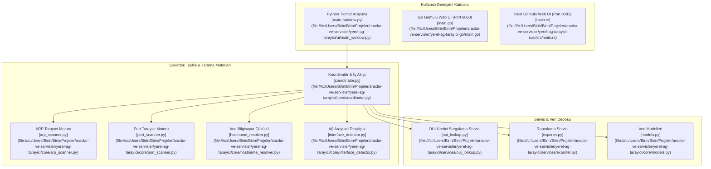

# 🌐 Yerel Ağ Tarayıcı (Local Network Scanner Ecosystem)

Modern, çok dilli (Python / Go / Rust) mimariye sahip yüksek başarımlı yerel ağ keşif, ARP tarama, port teşhis ve cihaz analiz ekosistemi.

---

## 🎯 1. Projenin Amacı ve Kapsamı

Yerel Ağ Tarayıcı projesi; yerel alt ağdaki (LAN / Subnet) tüm aktif cihazları tespit etmek, MAC adresi üzerinden donanım üreticisini (OUI) belirlemek, açık portları ve çalışan servisleri haritalandırmak, sunucu/yönlendirici/iş istasyonu ayırımı yapmak ve bu verileri dışa aktarmak (JSON, CSV, HTML) amacıyla geliştirilmiştir.

Proje 3 tamamlayıcı dikeyde uygulanmıştır:
1. **Python Referans & Masaüstü Uygulaması (`yerel-ag-tarayici`):** Tkinter tabanlı modern grafik arayüz, temiz katmanlı mimari, modüler test süiti (`pytest`).
2. **Go Yüksek Hızlı Motoru (`yerel-ag-tarayici-go`):** Eşzamanlı Goroutine havuzu, doğrudan `iphlpapi.dll` Windows API çağrısı, gömülü web arayüzü ve tek tıkla çalışabilir bağımsız binary (`yerel-ag-tarayici.exe`).
3. **Rust Bellek Güvenli Mikro-Servisi (`yerel-ag-tarayici-rust`):** Rayon iş parçacığı havuzu, sıfır maliyetli soyutlamalar, `tiny_http` sunucusu ve milisaniye altı ARP gecikme ölçümü.

---

## 🚀 2. Temel Özellikler

- **Donanım Seviyesinde Hızlı ARP Taraması:** Windows `SendARP` API'si üzerinden ARP yayınları göndererek ICMP/Ping filtrelerini aşan kesin cihaz tespiti.
- **Akıllı Cihaz Sınıflandırması:** Port analizine ve OUI üretici profillerine göre cihazları otomatik etiketleme (`Sunucu`, `Yönlendirici / Ağ Cihazı`, `Yazıcı`, `Bilgisayar / İstemci`, `Mobil / IoT`).
- **Çoklu Port & Servis Taraması:** Yaygın servis portlarının (HTTP, HTTPS, SSH, FTP, SMB, RDP, DNS, Telnet) yanı sıra özel tanımlanabilir port bloklarının taranması.
- **Genişletilmiş OUI Veritabanı:** MAC adresi öneklerinden üretici tespiti (Apple, Samsung, Intel, TP-Link, Xiaomi vb.) ve çevrimdışı yerel önbellekleme.
- **Çok Formatlı Raporlama:** Taranan verilerin CSV, JSON ve stilize edilmiş HTML rapor formatlarına aktarımı.
- **Üçlü Çalışma Modu:**
  - Masaüstü GUI Modu (Python Tkinter)
  - Hafif Web Arayüzü Modu (Go / Rust gömülü HTTP sunucuları)
  - Komut Satırı / Başsız Otomasyon Modu

---

## 🏗️ 3. Mimari & Teknoloji Yığını (Stack)

### 3.1. Çok Dilli Ekosistem Mimarisi



### 3.2. Teknoloji Bileşenleri

| Bileşen | Dil / Araç | Sürüm | Görev |
| :--- | :--- | :--- | :--- |
| **Masaüstü Arayüz** | Python (Tkinter + ttk) | 3.9+ | Modern koyu tema, canlı liste ve durum çubuğu |
| **Python Çekirdek** | Standart Kütüphane (`socket`, `subprocess`, `threading`) | 3.9+ | Sıfır harici C bağımlılığı ile taşınabilir çalışma |
| **Go Motoru** | Go (`syscall`, `net`, `sync`) | 1.22+ / 1.27 | Windows `iphlpapi.dll` FFI, Goroutine worker pool, Web UI |
| **Rust Motoru** | Rust (`rayon`, `tiny_http`, `serde`) | 2021 Edition | Çok iş parçacıklı güvenli paralelleştirme, sıfır bellek sızıntısı |
| **Test Altyapısı** | Pytest, Pytest-cov | En güncel | Kapsamlı birim ve entegrasyon testleri |

---

## 🗺️ 4. Proje Bilgi Grafiği & Sembol Haritası (Graphify / Yapı)

### 4.1. Dizin ve Dosya Haritası

```
araclar-ve-servisler/
├── yerel-ag-tarayici/                      # Python Ana Masaüstü Projesi
│   ├── main.py                            # GUI Uygulama Giriş Noktası
│   ├── pytest.ini                         # Test Konfigürasyonu
│   ├── core/                              # Temel Ağ Mantığı Katmanı
│   │   ├── models.py                      # Device, PortInfo, ScanStatus sınıfları
│   │   ├── arp_scanner.py                 # ARP paket ve komut tarayıcısı
│   │   ├── port_scanner.py                # Asenkron soket port tarama motoru
│   │   ├── hostname_resolver.py           # NetBIOS / DNS isim çözümleyici
│   │   ├── interface_detector.py          # Ağ kartı ve alt ağ CIDR bulucu
│   │   └── coordinator.py                 # Tarama yaşam döngüsü orkestratörü
│   ├── services/                          # Yan Servis Katmanı
│   │   ├── oui_lookup.py                  # MAC adresi üretici çözümleme servisi
│   │   └── exporter.py                    # JSON/CSV/HTML dışa aktarma servisi
│   ├── ui/                                # Grafik Arayüz Katmanı
│   │   ├── main_window.py                 # NetworkScannerApp pencere bileşeni
│   │   └── theme.py                       # Modern Koyu Arayüz Teması
│   └── tests/                             # Birim Test Süiti
│       ├── conftest.py                    # Mock armatürleri
│       ├── test_scanner_core.py           # Tarayıcı çekirdek testleri
│       ├── test_oui_db.py                 # OUI veritabanı testleri
│       └── test_exporter.py               # Dışa aktarma testleri
│
├── yerel-ag-tarayici-go/                   # Go Yüksek Hızlı Motoru
│   ├── main.go                            # Windows FFI, Goroutine havuzu ve Web UI
│   ├── go.mod                             # Go modül tanımı
│   ├── baslat.bat                         # Tek tıkla derleme/başlatma betiği
│   └── baslat.ps1                         # İmzalı PowerShell başlatıcısı
│
└── yerel-ag-tarayici-rust/                 # Rust Mikro-Servisi
    ├── Cargo.toml                         # Rayon & Serde bağımlılıkları
    ├── src/main.rs                        # Windows SendARP FFI, tiny_http sunucusu
    ├── baslat.bat                         # Derleme ve çalıştırma betiği
    └── baslat.ps1                         # İmzalı PowerShell başlatıcısı
```

### 4.2. Temel Semboller ve Dosya Bağlantıları

- [`NetworkScannerApp`](file:///c:/Users/Birin/Birin/Projeler/araclar-ve-servisler/yerel-ag-tarayici/ui/main_window.py): Tkinter arayüz yöneticisi, arama kutuları, tablo modeli ve arka plan iş parçacığı yönetimi.
- [`ScanCoordinator`](file:///c:/Users/Birin/Birin/Projeler/araclar-ve-servisler/yerel-ag-tarayici/core/coordinator.py): Tarama akışını başlatan, durduran ve olayları UI ile senkronize eden ana orkestratör.
- [`Device`](file:///c:/Users/Birin/Birin/Projeler/araclar-ve-servisler/yerel-ag-tarayici/core/models.py#L28): Ağdaki tekil cihazı temsil eden dondurulmuş (frozen) veri sınıfı (IP, MAC, Üretici, Hostname, Portlar, Cihaz Türü).
- [`PortInfo`](file:///c:/Users/Birin/Birin/Projeler/araclar-ve-servisler/yerel-ag-tarayici/core/models.py#L21): Port numarası, servis adı, durum (`open`/`closed`) ve yanıt süresi modeli.
- [`ArpScanner`](file:///c:/Users/Birin/Birin/Projeler/araclar-ve-servisler/yerel-ag-tarayici/core/arp_scanner.py): Windows ARP tablosu ve ICMP ping tarayıcı iş parçacığı.
- [`PortScanner`](file:///c:/Users/Birin/Birin/Projeler/araclar-ve-servisler/yerel-ag-tarayici/core/port_scanner.py): Eşzamanlı TCP soket bağlantılarıyla açık portları belirleyen motor.
- [`OuiLookupService`](file:///c:/Users/Birin/Birin/Projeler/araclar-ve-servisler/yerel-ag-tarayici/services/oui_lookup.py): OUI ön eklerini üretici firma adlarına çeviren yerel arama motoru.
- [`DataExporter`](file:///c:/Users/Birin/Birin/Projeler/araclar-ve-servisler/yerel-ag-tarayici/services/exporter.py): Cihaz listelerini CSV, JSON ve HTML raporlarına dönüştüren servis.
- [`Go Engine sendARP`](file:///c:/Users/Birin/Birin/Projeler/araclar-ve-servisler/yerel-ag-tarayici-go/main.go#L116): Go çalışma zamanında Windows `iphlpapi.dll` çağrısıyla doğrudan Layer-2 ARP paketi gönderici.
- [`Rust Engine execute_scan`](file:///c:/Users/Birin/Birin/Projeler/araclar-ve-servisler/yerel-ag-tarayici-rust/src/main.rs#L242): Rayon paralel iş parçacığı havuzuyla CIDR aralığını saniyeler içinde tarayan fonksiyon.

---

## 🤖 5. İlgili Agent Becerileri (Skills) ve Kuralları

Bu projeye atanan herhangi bir yapay zeka ajanı, sıfır oryantasyon süresiyle geliştirmeye başlamak için aşağıdaki kuralları ve becerileri uygulamalıdır:

### 5.1. Zorunlu Beceriler (Skills)
- **`rust-patterns`**: Rust mikro-servisinde (`yerel-ag-tarayici-rust`) yapılacak geliştirmelerde `Arc<RwLock<AppState>>` modelini koru, veri yarışlarını (data race) önle, `Rayon::into_par_iter` kullanarak iş parçacığı sınırlarını CPU çekirdek sayısına göre dinamik ayarla.
- **`golang-patterns`**: Go uygulamasında (`yerel-ag-tarayici-go`) goroutine kaçaklarını (goroutine leaks) engellemek için `context.WithTimeout` veya `sync.WaitGroup` kalıplarını eksiksiz kullan. Windows FFI çağrılarında bellek hizalamasını (`uintptr`) koru.
- **`targeted-error-locator`**: Ağ soket hataları (WSAETIMEDOUT, WSAECONNREFUSED) ve ARP yayın zaman aşımlarında, sorunun yerel güvenlik duvarından mı yoksa hedef ana bilgisayar filtrelemesinden mi kaynaklandığını cerrahi satır analiziyle tespit et.
- **`subagent-token-sentinel`**: Projedeki büyük dosyaları (örneğin 700+ satırlık `main.go` veya 800+ satırlık `main.rs`) tek seferde okuma; cerrahi dilimleme (`Select-String` + `StartLine`/`EndLine`) kullan.

### 5.2. Ajan Geliştirme Yönergeleri
1. **Çift Yönlü Güvenlik:** Ağ taraması esnasında ağ kartını aşırı yüklememek için IP blokları maksimum 256 eşzamanlı soket ile sınırlandırılmalıdır.
2. **Sıfır Harici Paket Kuralı (Python):** Python çekirdeği Scapy gibi ağır ve pcap sürücüsü gerektiren kütüphanelere bağımlı olmaksızın, doğrudan saf Python standart kütüphanesi ile çalışabilmelidir.
3. **Cross-Platform & Windows Uyumu:** Windows sistemlerde `iphlpapi.dll` SendARP önceliklidir; Linux ortamına geçildiğinde `/proc/net/arp` okuması fallback mekanizması olarak korunmalıdır.

---

## ⚙️ 6. Kurulum ve Çalıştırma Talimatları

### 6.1. Python Masaüstü Uygulaması

```powershell
# Proje dizinine geçiş
cd "c:\Users\Birin\Birin\Projeler\araclar-ve-servisler\yerel-ag-tarayici"

# Testleri icra etme
pytest -v

# Masaüstü grafik arayüzünü başlatma
python main.py
```

### 6.2. Go Motorunu Çalıştırma

```powershell
cd "c:\Users\Birin\Birin\Projeler\araclar-ve-servisler\yerel-ag-tarayici-go"

# Tek tıkla çalıştırma betiği
.\baslat.bat

# Veya doğrudan derleyip çalıştırma
go run main.go
# Tarayıcıda açılacak adres: http://localhost:8080
```

### 6.3. Rust Motorunu Çalıştırma

```powershell
cd "c:\Users\Birin\Birin\Projeler\araclar-ve-servisler\yerel-ag-tarayici-rust"

# Tek tıkla çalıştırma betiği
.\baslat.bat

# Veya doğrudan kargo ile başlatma
cargo run --release
# Tarayıcıda açılacak adres: http://localhost:8081
```
