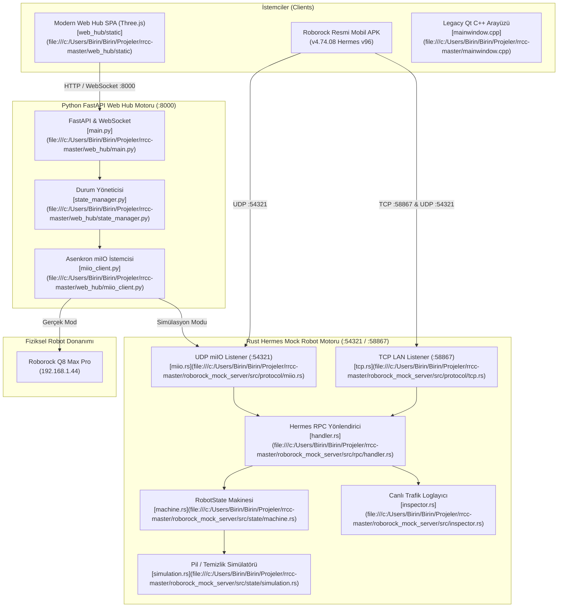

# 🤖 Roborock Control Center & Hermes v96 RPC Mock Ecosystem (RRCC)

Akıllı robot süpürgeler (Roborock Q8 Max Pro ve tüm miIO serisi) için geliştirilmiş; orijinal C++ Qt masaüstü kontrol merkezini, modern Python FastAPI + Three.js Glassmorphism Web Hub'ı ve Rust Tokio tabanlı **Hermes v96 RPC Mock Sunucusunu** bir araya getiren kapsamlı telemetri, simülasyon ve kontrol ekosistemi.

---

## 🎯 1. Projenin Amacı ve Kapsamı

RRCC ekosistemi; Roborock robot süpürgelerin bulut bağımlılığını ortadan kaldırarak yerel ağ (LAN) üzerinden tam kontrolünü sağlamak, resmi mobil uygulamanın (v4.74.08) Hermes v96 bytecode protokollerini tersine mühendislikle deşifre etmek ve fiziksel robota ihtiyaç duymadan uygulama geliştirmeyi mümkün kılan donanım seviyesinde bir simülatör sunmak amacıyla tasarlanmıştır.

Ekosistem 3 temel bileşenden oluşur:
1. **Rust Hermes v96 Mock Sunucusu (`roborock_mock_server`):** UDP 54321 (miIO) ve TCP 58867 (LocalClientService) portlarını dinleyen, milisaniye altı gecikmeli (700-800 µs), canlı JSONL trafik kayıtçılı ve durum makineli simülatör.
2. **Modern Web Kontrol Merkezi (`web_hub`):** Python FastAPI, WebSocket canlı telemetri, Three.js 3D ev planı görselleştiricisi ve neon cam morfizm (glassmorphism) temalı kontrol paneli.
3. **Klasik Masaüstü İstemcisi (Legacy Qt/C++):** Çevrimdışı harita çıkarma, ses paketi yükleme ve doğrudan firmware yönetimi sunan orijinal C++ aracı (`rrcc.exe`).

---

## 🚀 2. Temel Özellikler

- **Çift Protokol Dinleme (Dual-Protocol Server):**
  - **UDP 54321 (miIO):** AES-128-CBC şifreli el sıkışma (handshake), DID ve zaman damgası senkronizasyonu.
  - **TCP 58867 (Roborock LAN):** Mobil uygulamanın yerel bağlandığı `LocalClientService` soket akışı ve DoS korumalı birleşik JSON ayrıştırıcısı (`find_next_json_object`).
- **Hermes v96 RPC Metot Kataloğu:**
  - Oda Temizliği (`app_segment_clean`, `resume_segment_clean`)
  - Bölgesel Temizlik (`app_zoned_clean`, `resume_zoned_clean`)
  - Emiş Gücü & Su Ayarları (`set_clean_motor_mode` 101-105, `set_water_box_custom_mode` 200-203, `set_mop_mode`)
  - İstasyon ve Paspas Yıkama (`app_start_collect_dust`, `app_start_wash`, `app_stop_wash`)
  - Çok Katmanlı Harita Yönetimi (`get_multi_maps_list`, `load_multi_map`, `save_map`)
  - Sarf Malzeme Takibi ve Sıfırlama (`reset_consumable`, filtre, ana fırça, yan fırça, sensörler)
- **Canlı Paket Denetçisi ve JSONL Kayıtçısı (`traffic_log.jsonl`):**
  - Gelen/giden her JSON-RPC çağrısını zaman damgası, gecikme süresi (`elapsed_us`) ve soket bilgisiyle yapılandırılmış günlükleme.
- **Katman 7 & Katman 2 MAC Klonlama Desteği:**
  - Mock sunucuda `--mac` parametresi ile robotun kimliğini emüle etme.
- **İnteraktif 3D Harita ve Glassmorphism Web Arayüzü:**
  - Three.js + OrbitControls ile 3D kat planı HUD'ı, SVG radyal batarya göstergesi, tek tıkla oda temizleme butonları.
- **Fiziksel VPN / Tünel Baypası:**
  - Kaspersky VPN veya sanal ağ adaptörlerine takılmadan doğrudan fiziksel LAN IP'sine soket bağlama mimarisi.

---

## 🏗️ 3. Mimari & Teknoloji Yığını (Stack)

### 3.1. Ağ ve İletişim Mimarisi



### 3.2. Teknoloji Bileşenleri

| Bileşen | Dil & Altyapı | Sürüm | Görev |
| :--- | :--- | :--- | :--- |
| **Hermes Mock Server** | Rust (Tokio, Serde, AES, MD5) | 1.80+ | 1.56 MB tek binary, asenkron miIO/TCP sunucusu |
| **Web Hub Backend** | Python (FastAPI, Uvicorn, PyCryptodome) | 3.10+ | REST API, WebSocket telemetrisi, cihaz poller |
| **Web Hub Frontend** | HTML5, CSS3 Glassmorphism, Three.js | 0.160+ | 3D kat planı HUD, oda temizlik butonları |
| **Legacy GUI** | C++ (Qt 5.12+) | C++11 | Klasik firmware ve harita yönetim masaüstü aracı |
| **Trafik Analizi** | JADX decompiler, Hermes v96 disassembler | v4.74.08 APK | Resmi protokol ve metot çözümlemesi |

---

## 🗺️ 4. Proje Bilgi Grafiği & Sembol Haritası (Graphify / Yapı)

### 4.1. Dizin Yapısı

```
rrcc-master/
├── PROJECT_STATE.md                  # Canlı proje hafızası ve protokol günlüğü
├── Baslat.ps1                        # İmzalı genel başlatıcı menüsü
├── Baslat_Mock_Server.ps1            # İmzalı Rust Hermes Mock Server başlatıcısı
├── Baslat_Web.ps1                    # İmzalı Python Web Hub başlatıcısı
├── Roborock - v4.74.08.apk           # Tersine mühendislik referans APK'sı
├── rrcc.exe                          # Klasik Qt masaüstü çalıştırılabilir dosyası
│
├── roborock_mock_server/             # Rust Hermes v96 Mock Robot Sunucusu
│   ├── Cargo.toml                    # Tokio, serde, aes-modes bağımlılıkları
│   └── src/
│       ├── main.rs                   # CLI argümanları ve çift soket orkestrasyonu
│       ├── config.rs                 # IP, port, token ve MAC yapılandırması
│       ├── crypto.rs                 # AES-128-CBC şifreleme/çözme motoru
│       ├── inspector.rs              # Renkli konsol ve JSONL trafik loglayıcı
│       ├── protocol/
│       │   ├── miio.rs               # UDP 54321 miIO el sıkışma ve paketleyici
│       │   └── tcp.rs                # TCP 58867 Roborock LocalClient akış dinleyici
│       ├── rpc/
│       │   ├── types.rs              # JsonRpcRequest ve JsonRpcResponse tipleri
│       │   └── handler.rs            # 30+ Hermes v96 RPC metot işleyicisi
│       └── state/
│           ├── machine.rs            # Thread-safe RobotState durum makinesi
│           └── simulation.rs         # Pil tüketimi ve temizlik simülatörü
│
├── web_hub/                          # Modern Python FastAPI Web Kontrol Merkezi
│   ├── main.py                       # FastAPI REST ve WebSocket uç noktaları
│   ├── miio_client.py                # Asenkron Python miIO şifreli soket istemcisi
│   ├── state_manager.py              # Telemetri önbelleği ve durum çevirici
│   ├── config.py                     # Cihaz IP, port, token ve DUID ayarları
│   ├── test_main.py                  # Pytest birim test süiti
│   └── static/                       # Three.js 3D kat planı ve arayüz dosyaları
│
└── ext/ lng/ res/                    # Klasik C++ Qt kaynakları ve çevirileri
```

### 4.2. Temel Semboller ve Dosya Bağlantıları

- [`RoborockMockServer::main`](file:///c:/Users/Birin/Birin/Projeler/rrcc-master/roborock_mock_server/src/main.rs): Tokio çalışma zamanında UDP 54321 ve TCP 58867 soketlerini eşzamanlı ayağa kaldıran ana döngü.
- [`RpcHandler::dispatch`](file:///c:/Users/Birin/Birin/Projeler/rrcc-master/roborock_mock_server/src/rpc/handler.rs): Gelen JSON-RPC metodunu (`app_segment_clean`, `get_status`, `load_multi_map` vb.) ayrıştırıp yanıt üreten yönlendirici.
- [`TcpStreamHandler::find_next_json_object`](file:///c:/Users/Birin/Birin/Projeler/rrcc-master/roborock_mock_server/src/protocol/tcp.rs): TCP soketinde birleşik gelen JSON paketlerini küme parantezi sayımıyla DoS korumalı ayrıştıran fonksiyon.
- [`RobotState`](file:///c:/Users/Birin/Birin/Projeler/rrcc-master/roborock_mock_server/src/state/machine.rs): Batarya seviyesi, fan gücü, su seviyesi, temizlik süresi ve hata kodlarını tutan thread-safe model.
- [`PacketInspector`](file:///c:/Users/Birin/Birin/Projeler/rrcc-master/roborock_mock_server/src/inspector.rs): İstek ve yanıtları mikrosaniye hassasiyetinde ekrana basan ve `traffic_log.jsonl` dosyasına yazan motor.
- [`AsyncMiioClient`](file:///c:/Users/Birin/Birin/Projeler/rrcc-master/web_hub/miio_client.py): Python tarafında AES-128-CBC şifreli UDP miIO paketlerini gönderip yanıt bekleyen asenkron istemci.
- [`StateManager`](file:///c:/Users/Birin/Birin/Projeler/rrcc-master/web_hub/state_manager.py): Robot durumunu periyodik sorgulayan ve sarf malzeme ömürlerini hesaplayan servis.

---

## 🤖 5. İlgili Agent Becerileri (Skills) ve Kuralları

Bu projede kod geliştirecek yapay zeka ajanları aşağıdaki tasarım standartlarına uymalıdır:

### 5.1. Zorunlu Beceriler (Skills)
- **`rust-patterns`**: `roborock_mock_server` üzerinde çalışırken bellek tahsislerini minimumda tut (`zero-copy` dilimleme), `Arc<RwLock<RobotState>>` kilitlerini kritik bölge biter bitmez serbest bırak, Tokio `select!` makrosunu asenkron soket dinlemelerinde hatasız kullan.
- **`fastapi-patterns`**: `web_hub` üzerinde geliştirme yaparken WebSocket bağlantılarının istemci kopmalarında (`WebSocketDisconnect`) temiz bir şekilde havuzdan çıkarılmasını sağla.
- **`subagent-token-sentinel`**: 500+ satırlık `handler.rs` ve `tcp.rs` dosyalarında cerrahi aralıklar (`Select-String` + `StartLine`/`EndLine`) ile çalış.

### 5.2. Ajan Geliştirme Yönergeleri
1. **Hermes Bytecode Protokol Uyumu:** `get_prop` metoduna verilen parametrelere (`["battery"]` vs `["get_status"]`) verilen yanıt tipi birebir resmi uygulamanın beklediği skaler veya dizi formatında olmalıdır.
2. **Kriptografik Bütünlük:** miIO paketlerindeki MD5 anahtar türetimi (`Key = MD5(Token)`, `IV = MD5(Key + Token)`) bozulmamalıdır.
3. **PowerShell İmzası:** Değiştirilen veya yeni üretilen PowerShell betikleri projenin geçerli Authenticode sertifikası ile imzalanmalıdır.

---

## ⚙️ 6. Kurulum ve Çalıştırma Talimatları

### 6.1. Rust Hermes Mock Sunucusunu Başlatma

```powershell
cd "c:\Users\Birin\Birin\Projeler\rrcc-master"

# İmzalı başlatıcı ile:
.\Baslat_Mock_Server.ps1

# Veya doğrudan Cargo ile:
cd roborock_mock_server
cargo run --release -- --port 54321 --tcp-port 58867 --mac "00:11:22:33:44:55"
```

### 6.2. Modern Web Hub Kontrol Merkezini Başlatma

```powershell
cd "c:\Users\Birin\Birin\Projeler\rrcc-master"

# İmzalı web başlatıcısı ile:
.\Baslat_Web.ps1

# Veya Python FastAPI üzerinden doğrudan:
cd web_hub
pip install -r requirements.txt
python main.py
# Tarayıcıda açılacak adres: http://localhost:8000
```

### 6.3. Test Süitini Çalıştırma

```powershell
# Rust Mock Server Birim ve Entegrasyon Testleri (21/21 test)
cd "c:\Users\Birin\Birin\Projeler\rrcc-master\roborock_mock_server"
cargo test

# Python Web Hub API Testleri (6/6 test)
cd "c:\Users\Birin\Birin\Projeler\rrcc-master\web_hub"
pytest test_main.py -v
```
