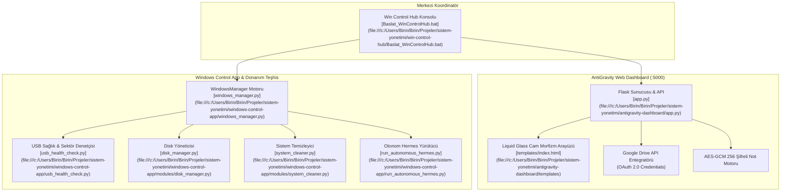

# 🎛️ Sistem Yönetimi (Windows System Administration & Control Suite)

Windows işletim sistemini yerel veya uzaktan tarayıcı üzerinden izlemek, yönetmek, optimize etmek ve donanım sağlığını denetlemek için tasarlanmış kapsamlı yönetim ekosistemi.

---

## 🎯 1. Projenin Amacı ve Kapsamı

Sistem Yönetimi paketi; Windows kullanıcılarına ve sistem yöneticilerine donanım kaynaklarını (CPU, RAM, Disk) anlık izleme, geçici ve kilitli sistem çöplerini temizleme, güç ve kapatma zamanlayıcılarını yönetme, USB belleklerin fiziksel ve dosya sistemi sağlık durumunu denetleme ve Google Drive entegrasyonuyla güvenli bulut yedeklemesi yapma imkanı tanır.

Paket 3 birbirini tamamlayan modülden meydana gelir:
1. **AntiGravity Dashboard (`antigravity-dashboard`):** Şık "Liquid Glass" (Cam Morfizm) temalı, responsive web dashboard'u (Flask + Vanilla JS), AES-256-GCM yerel şifreli yapışkan notlar ve 5 TB Google Drive depolama yöneticisi.
2. **Win Control Hub (`win-control-hub`):** Tüm Windows yönetim modüllerini tek bir menü altından koordine eden, sanal ortam (venv) doğrulayıcı ve servis başlatıcı konsol.
3. **Windows Control App & USB Health (`windows-control-app`):** WMI destekli fiziksel donanım sorgulayıcı, `chkdsk` ve sektör analizli USB sağlık denetçisi (`usb_health_check.py`) ve Hermes otonom görev yürütücüsü.

---

## 🚀 2. Temel Özellikler

- **Gerçek Zamanlı Sistem Telemetrisi (Liquid Glass Dashboard):**
  - CPU, RAM ve C: Sürücüsü doluluk oranlarını neon radyal göstergelerle anlık izleme.
  - Sistem çalışma süresi (uptime), akıllı saat/tarih ve karşılama widget'ı.
- **Akıllı Disk & Sistem Temizliği (`DiskCleaner` / `SystemCleaner`):**
  - Windows Temp, User Temp, Prefetch ve kilitli önbellek dosyalarını tarama, boyut hesaplama ve kilitli dosyalara takılmadan güvenli temizlik.
- **Gelişmiş Güç & Kapatma Zamanlayıcısı:**
  - Bilgisayarı belirlenen süre (dakika) sonunda kapatma, yeniden başlatma veya uykuya alma; iptal ve geri sayım takibi.
- **Sıfır-Bilgi (Zero-Knowledge) AES-256-GCM Şifreli Notlar:**
  - Tarayıcıda istemci tarafında parola ile şifrelenen, parola bilinmedikçe sunucu tarafından dahi çözülemeyen yapışkan notlar.
  - Tek tıkla tüm notları `antigravity_sticky_notes.enc` olarak Google Drive'a yedekleme ve geri yükleme.
- **Google Drive Entegrasyonu (5 TB Bulut Gezgini):**
  - Bulut kapasitesi, doluluk oranı ve kota takibi.
  - Yerel klasörleri anında `.zip` haline getirip doğrudan Google Drive'a yükleme.
- **USB Bellek Sağlık ve Sektör Denetimi (`usb_health_check.py`):**
  - WMI donanım kimliği tespiti, dosya sistemi bütünlüğü (`chkdsk`) ve isteğe bağlı okuma/yazma sektör sağlığı testi.
- **Otonom Hermes Görev Entegrasyonu (`run_autonomous_hermes.py`):**
  - Sistem optimizasyonunu ve denetim scriptlerini otonom arka plan ajanlarıyla yürütme desteği.

---

## 🏗️ 3. Mimari & Teknoloji Yığını (Stack)

### 3.1. Modüler Sistem Mimarisi



### 3.2. Teknoloji Bileşenleri

| Bileşen | Teknoloji / Kütüphane | Amaç |
| :--- | :--- | :--- |
| **Dashboard Backend** | Python 3.9+, Flask, psutil | Donanım metriklerini çekme ve REST uç noktaları sağlama |
| **Dashboard Frontend** | HTML5, CSS3 Glassmorphism, Vanilla JS | Sıfır NPM bağımlılıklı, hafif, sıvı cam efektli responsive arayüz |
| **Bulut Entegrasyonu** | Google Client Library, Google Drive API v3 | OAuth 2.0 yetkilendirmesi, kota sorgusu ve dosya aktarımı |
| **Donanım Teşhis** | WMI (Windows Management Instrumentation), Subprocess | Fiziksel sürücü seri no, model, SMART ve chkdsk yürütme |
| **Şifreleme Katmanı** | Web Cryptography API (SubtleCrypto) | İstemci tarafında donanım hızlandırmalı AES-GCM 256 |

---

## 🗺️ 4. Proje Bilgi Grafiği & Sembol Haritası (Graphify / Yapı)

### 4.1. Modül Ağacı

```
sistem-yonetimi/
├── README.md                         # Bu teknik dokümantasyon
│
├── antigravity-dashboard/            # Cam Morfizm Web Kontrol Paneli
│   ├── app.py                        # Flask API ve sistem izleyici
│   ├── requirements.txt              # Flask, psutil, google-api-python-client
│   ├── Baslat_AntiGravity.bat        # Tek tıkla dashboard başlatıcı
│   ├── build_app.bat                 # PyInstaller tek dosya EXE derleyici
│   ├── templates/                    # HTML5 Cam Morfizm şablonları
│   └── static/                       # CSS stilleri, ambient ışıklar, JS motoru
│
├── win-control-hub/                  # Merkezi Yönetim ve Başlatıcı Konsolu
│   ├── Baslat_WinControlHub.bat      # Ortam doğrulama ve koordinasyon menüsü
│   └── .venv/                        # İzolasyonlu Python sanal çalışma alanı
│
└── windows-control-app/              # Donanım Teşhis ve Sistem Yönetimi
    ├── Baslat_WindowsControlApp.bat  # CLI yönetim menüsü
    ├── windows_manager.py            # Windows API ve yönetim koordinatörü
    ├── usb_health_check.py           # USB fiziksel disk ve chkdsk kontrol aracı
    ├── run_autonomous_hermes.py      # Otonom Hermes arka plan görev motoru
    └── modules/
        ├── disk_manager.py           # Sürücü listeleme ve analiz
        ├── system_cleaner.py         # Temp ve çöp dosya temizliği
        └── update_manager.py         # Windows Update durumu ve denetimi
```

### 4.2. Temel Semboller ve Dosya Bağlantıları

- [`AntiGravityDashboardApp`](file:///c:/Users/Birin/Birin/Projeler/sistem-yonetimi/antigravity-dashboard/app.py): Flask rotalarını (`/api/system-stats`, `/api/clean-temp`, `/api/schedule-power`, `/api/drive/*`) yöneten ana sunucu.
- [`Baslat_WinControlHub`](file:///c:/Users/Birin/Birin/Projeler/sistem-yonetimi/win-control-hub/Baslat_WinControlHub.bat): Python ortamını doğrulayıp alt servisleri ayağa kaldıran yönetim menüsü.
- [`WindowsManager`](file:///c:/Users/Birin/Birin/Projeler/sistem-yonetimi/windows-control-app/windows_manager.py): Disk, servis, güncelleme ve temizlik modüllerini tek çatı altında toplayan arayüz.
- [`UsbHealthCheck`](file:///c:/Users/Birin/Birin/Projeler/sistem-yonetimi/windows-control-app/usb_health_check.py): USB sürücülerin WMI kimliklerini alan ve `chkdsk` / sektör doğrulaması yapan CLI aracı.
- [`SystemCleaner`](file:///c:/Users/Birin/Birin/Projeler/sistem-yonetimi/windows-control-app/modules/system_cleaner.py): Kilitli dosya istisnalarını (`PermissionError`) yutarak temizlenebilir tüm geçici verileri temizleyen sınıf.

---

## 🤖 5. İlgili Agent Becerileri (Skills) ve Kuralları

Bu modüllerde geliştirme yapacak yapay zeka ajanları aşağıdaki kurallara bağlı kalmalıdır:

### 5.1. Zorunlu Beceriler (Skills)
- **`liquid-glass-design`**: Dashboard arayüzünde cam morfizm standartlarını koru: yarı saydam arka planlar (`rgba(255, 255, 255, 0.05)`), `backdrop-filter: blur(16px)`, neon kenar çizgileri (`border: 1px solid rgba(255, 255, 255, 0.1)`) ve dinamik ışık küreleri (ambient light blobs).
- **`python-patterns`**: Sistem yönetim scriptlerinde Windows erişim engellerini (`AccessDenied`, `PermissionError`) zarif bir şekilde yönet; kilitli dosyalarda işlemi durdurmak yerine atlayıp başarıyla temizlenen toplam boyutu raporla.
- **`subagent-token-sentinel`**: `app.py` ve `windows_manager.py` gibi 300+ satırlık dosyalarda cerrahi okuma yap.

### 5.2. Ajan Geliştirme Yönergeleri
1. **Güç Yönetimi Güvenliği:** Bilgisayarı kapatma (`shutdown /s`) veya yeniden başlatma emirleri verilmeden önce mutlaka kullanıcıya onay diyaloğu sunulmalı ve geri sayım zamanlayıcısı iptal edilebilir (`shutdown /a`) olmalıdır.
2. **Korumalı Dosya Sistemi:** Disk temizleme işlemi asla sistem kritik dizinlerine (`C:\Windows\System32`) erişmemeli; yalnızca `%TEMP%` ve `C:\Windows\Temp` klasörleri ile sınırlandırılmalıdır.
3. **Google API Kimlik Bilgileri:** `credentials.json` ve `token.pickle` dosyaları kesinlikle Git sürüm kontrolüne eklenmemelidir (`.gitignore` koruması).

---

## ⚙️ 6. Kurulum ve Çalıştırma Talimatları

### 6.1. AntiGravity Dashboard'u Başlatma

```powershell
cd "c:\Users\Birin\Birin\Projeler\sistem-yonetimi\antigravity-dashboard"

# Bağımlılıkları yükleyin
pip install -r requirements.txt

# Uygulamayı başlatın
python app.py
# veya çift tıklama ile:
.\Baslat_AntiGravity.bat

# Tarayıcıda açılacak adres: http://localhost:5000
```

### 6.2. Win Control Hub Koordinasyon Konsolunu Başlatma

```powershell
cd "c:\Users\Birin\Birin\Projeler\sistem-yonetimi\win-control-hub"
.\Baslat_WinControlHub.bat
```

### 6.3. USB Sağlık Kontrolünü Çalıştırma

```powershell
cd "c:\Users\Birin\Birin\Projeler\sistem-yonetimi\windows-control-app"
python usb_health_check.py
# veya hazır menü ile:
.\Baslat_WindowsControlApp.bat
```
