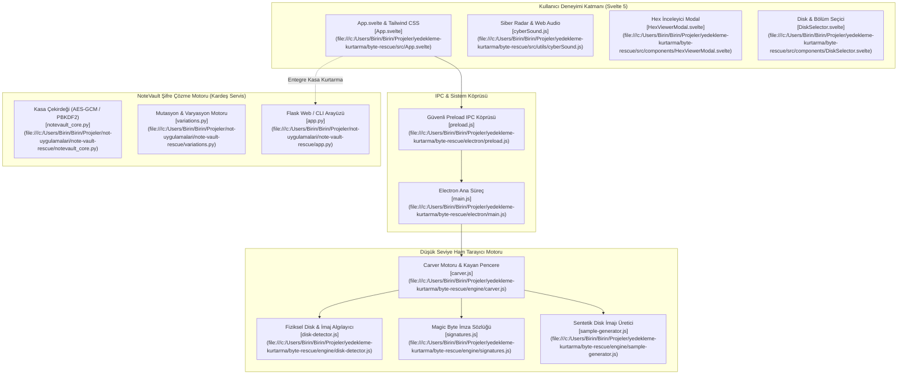

# ⚡ ByteRescue // Raw Sector Carver & Deep Data Recovery Suite

Modern, siber temalı, sıfır veri kaybı hedefli ham sektör (raw sector) dosya kurtarma ve şifreli veri kasası açma (NoteVault Decryptor) ekosistemi.

---

## 🎯 1. Projenin Amacı ve Kapsamı

ByteRescue, dosya tablosu (MFT, FAT, inode) tamamen bozulmuş, formatlanmış veya silinmiş depolama birimlerinden (HDD, SSD, USB bellek, SD kart, ham `.img`/`.dd`/`.bin` disk imajları) verileri bayt düzeyinde (carving) kurtarmak amacıyla inşa edilmiş yüksek performanslı masaüstü uygulamasıdır.

Ekosistem iki temel kurtarma bileşenini bir araya getirir:
1. **ByteRescue Deep Carver Engine (`byte-rescue`):** Electron + Svelte 5 + Node.js ham dosya akışlarıyla çalışan, 64 KB kayan pencere (sliding window overlap) teknolojisine sahip ham sektör tarayıcısı.
2. **NoteVault Kasa ve Şifre Kurtarma Motoru (`note-vault-rescue`):** Kardeş veri koruma modülü olarak; unutulmuş `.notevault` kasalarını saniyede 1.000.000+ parola varyasyonu deneyerek kurtaran, iki kademeli SHA-256 filtrelemeli ve AES-256-GCM çözücülü motor.

---

## 🚀 2. Temel Özellikler

- **Ham Sektör Taraması (File Carving):** Dosya sistemi metaverilerine ihtiyaç duymadan sihirli baytlar (magic bytes) ve dosya sonu (EOF) desenleri ile dosya kurtarma.
- **Kayan Pencere Örtüşme Koruması (Sliding Window Overlap):** 64 KB'lık sektör sınırlarında parçalanan dosyaların kesintisiz birleştirilmesini sağlayan tampon yönetimi.
- **Geniş Dosya İmzası Kütüphanesi:**
  - Görseller: PNG, JPEG, GIF87a/89a, WEBP, BMP
  - Belgeler & Ofis: PDF, DOCX, XLSX, PPTX, TXT
  - Medya & Ses: MP4, MOV, MKV, WebM, MP3, WAV, FLAC
  - Arşivler: ZIP, 7Z, RAR (v4/v5), TAR, GZ
  - Özel İmzalar (Custom Magic Bytes): Kullanıcının hex formatında girdiği bayt dizilerini arayabilme.
- **İnteraktif Hex İnceleyici (Hex Inspector Modal):** Bulunan sektörleri canlı onaltılık (hex) ve ASCII formatında anlık inceleme.
- **Siber Radar & Web Audio API:** Sıfır harici ses dosyası bağımlılığıyla Web Audio API osilatörleri üzerinden üretilen neon radar görselleştirmesi ve siber ses efektleri.
- **Güvenli Kurtarma Muhafazası (Safe Recovery Guard):** Kurtarılan dosyaların kesinlikle taranan kaynak sürücüye yazılmasını engelleyerek veri üzerine yazma (overwrite) felaketini önleme.
- **NoteVault Kasa Şifresi Kurtarıcı:** `.notevault` başlığındaki `SHA-256(salt + password)` doğrulaması sayesinde ağır PBKDF2 çalıştırmadan önce ultra hızlı filtreleme ile 1.000.000+ şifre/sn deneme kapasitesi.

---

## 🏗️ 3. Mimari & Teknoloji Yığını (Stack)

### 3.1. Sistem Mimarisi



### 3.2. Teknoloji Bileşenleri

| Katman | Teknoloji / Kütüphane | Kullanım Amacı |
| :--- | :--- | :--- |
| **Arayüz (Frontend)** | Svelte 5 (Runes), Tailwind CSS, Lucide Icons | Yüksek hızlı reaktif durum yönetimi, sıfır gecikmeli DOM güncellemeleri |
| **Masaüstü İskeleti** | Electron 33 | Güvenli `contextIsolation`, donanım disk erişim yetkileri |
| **G/Ç & Akış Motoru** | Node.js Raw Streams (`fs.readSync`, `Buffer.allocUnsafe`) | Bellek tüketimini sabit tutarak gigabaytlarca ham diski tarama |
| **Kasa Kurtarma Motoru**| Python 3, PyCryptodome, Multiprocessing | Çok çekirdekli hızlı SHA-256 doğrulama ve AES-256-GCM deşifreleme |
| **Paketleyici (Release)**| Electron Builder 24 (NSIS + Portable) | Bağımsız Windows x64 `.exe` ve kurulum sihirbazı |

---

## 🗺️ 4. Proje Bilgi Grafiği & Sembol Haritası (Graphify / Yapı)

### 4.1. Dizin Yapısı

```
yedekleme-kurtarma/byte-rescue/
├── Baslat_ByteRescue.bat             # Çift tıklama başlatıcısı
├── package.json                      # Bağımlılıklar ve derleme scriptleri
├── vite.config.js                    # Vite derleme yapılandırması
├── installer.nsi                     # NSIS kurulum betiği
├── electron/                         # Masaüstü Arka Plan Motoru
│   ├── main.js                       # Pencere yönetimi, IPC işleyicileri
│   ├── preload.js                    # window.electron API köprüsü
│   └── preload.cjs                   # CommonJS uyumluluk katmanı
├── engine/                           # Kurtarma Algoritmaları
│   ├── carver.js                     # Ham sektör bayt tarayıcısı (Carver)
│   ├── disk-detector.js              # Windows sürücüleri ve imaj tarayıcı
│   ├── signatures.js                 # Magic byte dosya tanımları
│   └── sample-generator.js           # 10 MB sanal test diski oluşturucu
├── src/                              # Svelte Kullanıcı Arayüzü
│   ├── App.svelte                    # Ana durum ve navigasyon
│   ├── main.js                       # Svelte montaj noktası
│   ├── app.css                       # Koyu siber neon stiller
│   ├── components/                   # UI Bileşenleri
│   │   ├── DiskSelector.svelte       # Sürücü listeleme ve seçim
│   │   ├── MetricCard.svelte         # Hız, sektör, dosya sayaçları
│   │   ├── PreviewModal.svelte       # Kurtarılan görsel önizleme
│   │   ├── HexViewerModal.svelte     # Canlı Hex döküm görüntüleyici
│   │   ├── CustomSignatureModal.svelte # Özel imza ekleme formu
│   │   └── AboutModal.svelte         # Sürüm ve lisans bilgisi
│   └── utils/
│       └── cyberSound.js             # Web Audio API siber ses sentezleyici
└── not-uygulamalari/note-vault-rescue/ # Entegre Kasa Çözme Motoru (Kardeş)
    ├── app.py                        # Web tabanlı şifre kurtarma paneli (Flask)
    ├── cli.py                        # Komut satırı hızlı brute-force aracı
    ├── notevault_core.py             # AES-GCM şifre çözme ve çıkartma motoru
    └── variations.py                 # Akıllı kelime mutasyon ve leet-speak motoru
```

### 4.2. Temel Semboller ve Dosya Bağlantıları

- [`Carver`](file:///c:/Users/Birin/Birin/Projeler/yedekleme-kurtarma/byte-rescue/engine/carver.js): Kayan pencere tamponuyla sektör sektör ham disk okuyan ve imzaları eşleştiren ana sınıf.
- [`DiskDetector`](file:///c:/Users/Birin/Birin/Projeler/yedekleme-kurtarma/byte-rescue/engine/disk-detector.js): Windows `wmic` veya `PowerShell Get-Volume` aracılığıyla fiziksel diskleri ve boyutlarını algılayan modül.
- [`FileSignatures`](file:///c:/Users/Birin/Birin/Projeler/yedekleme-kurtarma/byte-rescue/engine/signatures.js): PNG, JPG, PDF, ZIP vb. formatların başlık ve sonlandırıcı (footer) bayt haritası.
- [`SampleDiskGenerator`](file:///c:/Users/Birin/Birin/Projeler/yedekleme-kurtarma/byte-rescue/engine/sample-generator.js): Harici diski olmayan kullanıcılar için 10 MB sanal bozuk disk imajı üreten yardımcı.
- [`cyberSound`](file:///c:/Users/Birin/Birin/Projeler/yedekleme-kurtarma/byte-rescue/src/utils/cyberSound.js): Web Audio API osilatör frekanslarını modüle ederek radar 'bip' ve 'kurtarma tamamlandı' tonları üreten servis.
- [`NoteVaultCore`](file:///c:/Users/Birin/Birin/Projeler/not-uygulamalari/note-vault-rescue/notevault_core.py): Unutulmuş `.notevault` kasasını açan, notları JSON/TXT olarak dışarı aktaran çekirdek.
- [`VariationEngine`](file:///c:/Users/Birin/Birin/Projeler/not-uygulamalari/note-vault-rescue/variations.py): İpucu kelimelerden yüzbinlerce olası parola üreten dil ve klavye mutasyon motoru.

---

## 🤖 5. İlgili Agent Becerileri (Skills) ve Kuralları

Bu projede geliştirme yapacak yapay zeka ajanları aşağıdaki kuralları ve becerileri titizlikle uygulamalıdır:

### 5.1. Zorunlu Beceriler (Skills)
- **`codebase-design`**: IPC veri modelleri (`preload.js` -> `carver.js`) arasındaki mesaj protokolünü gevşek bağlı (loosely coupled) tut. Arayüze her bayt değişiminde değil, 100ms debounced aralıklarla telemetri gönder (`throttle` prensibi).
- **`data-autocleaning`**: Kurtarma işlemi esnasında tespit edilen geçici tamponları (temporary carving buffers) ve bozuk sektör parçalarını otomatik olarak serbest bırak (`Buffer.allocUnsafe` temizliği). Disk yazma döngülerinde yetim dosya kalıntılarını önle.
- **`subagent-token-sentinel`**: `carver.js` ve `disk-detector.js` gibi 400+ satırlık kritik motor dosyalarında cerrahi dilimleme (`StartLine`/`EndLine`) ile çalış.

### 5.2. Ajan Geliştirme Yönergeleri
1. **Hedef Sürücü Dokunulmazlığı:** Kurtarılan hiçbir veri, taranmakta olan kaynak sürücüye (`target_drive == source_drive`) yazılamaz. Kod seviyesinde sürücü harfi kıyaslaması zorunludur.
2. **Bellek Sınırı (Memory Capping):** 500 GB veya 1 TB'lık disk taranırken asla dosyanın tamamı belleğe okunmamalıdır. 64 KB sliding window blokları halinde akış (`stream`) kullanılmalıdır.
3. **NoteVault Entegrasyonu:** NoteVault kasalarını açarken asla doğrudan PBKDF2 döngüsüne girme; önce `header_hash == SHA256(salt + password)` doğrulaması yapılmalıdır.

---

## ⚙️ 6. Kurulum ve Çalıştırma Talimatları

### 6.1. Masaüstü Uygulamasını Başlatma (Geliştirici Modu)

```powershell
cd "c:\Users\Birin\Birin\Projeler\yedekleme-kurtarma\byte-rescue"

# Bağımlılıkları yükle
npm install

# Uygulamayı geliştirici modunda başlat
npm start
```

### 6.2. Bağımsız Windows `.exe` Derleme

```powershell
# Windows Kurulum Sihirbazı (NSIS) ve Taşınabilir (Portable) EXE Üretimi
npm run dist:win

# Çıktı klasörü: release/
# - ByteRescue Setup 1.2.0.exe
# - ByteRescue 1.2.0.exe
```

### 6.3. Kardeş Servis: NoteVault Şifre Kurtarıcıyı Başlatma

```powershell
cd "c:\Users\Birin\Birin\Projeler\not-uygulamalari\note-vault-rescue"

# Web Arayüzünü Başlatma (http://localhost:7890)
python app.py

# CLI Hızlı Tarama Örneği
python cli.py ornek_kasa.notevault -g "tahmin1" "tahmin2" -l fast
```
