# 📲 OmniBackupTransfer (Android / Ktor Local LAN Backup & Transfer Engine)

Harici bulut sağlayıcılarına veya internet bağlantısına ihtiyaç duymadan, Android cihazların yerel Wi-Fi veya Hotspot ağı üzerinden tam depolama ve WhatsApp yedeğini bilgisayara aktaran yüksek performanslı gömülü sunucu ve aktarım uygulaması.

---

## 🎯 1. Projenin Amacı ve Kapsamı

OmniBackupTransfer; USB kablosu, Google Drive veya üçüncü parti sunucular olmaksızın, Android cihaz ile yerel ağdaki herhangi bir tarayıcı (PC, Mac, Linux veya başka bir telefon) arasında güvenli, yüksek hızlı ve doğrudan dosya transferi sağlamak üzere geliştirilmiştir.

Uygulama, telefonda gömülü bir Ktor HTTP sunucusu başlatır; QR kod veya yerel IP (`http://192.168.x.x:8080`) aracılığıyla modern bir web paneli sunar ve dosyaları sunucu tarafında geçici disk alanı harcamaksızın canlı akış (on-the-fly zip streaming) tekniğiyle aktarır.

---

## 🚀 2. Temel Özellikler

- **Sıfır İnternet & %100 Yerel Güvenlik:** Tüm veri aktarımı yerel ağ katmanında (LAN / Wi-Fi Hotspot) gerçekleşir. Dış ağa hiçbir bayt sızmaz.
- **Canlı Zip Akışı (On-The-Fly Streaming):** Yüz binlerce dosya ve gigabaytlarca WhatsApp sohbet/medya yedeği telefonda geçici zip dosyası oluşturulmadan, doğrudan ağ soketine sıkıştırılarak pompalanır (0 MB ek depolama ihtiyacı).
- **Kapsamlı WhatsApp Yedek Sihirbazı (`WhatsAppScanner`):**
  - Android 11+ Scoped Storage konumlarını (`/sdcard/Android/media/com.whatsapp/WhatsApp/`) ve eski dizinleri otomatik bulur.
  - Şifreli veritabanları (`Databases/msgstore.db.crypt14/15`), sesler, fotoğraflar ve belgeleri kategorize eder.
- **Dinamik Gömülü Web Paneli (`WebAssets`):** Bilgisayara hiçbir yazılım yüklemeden, yalnızca Chrome/Firefox/Edge açarak telefon dosyalarını gezme, indirme ve bilgisayardan telefona dosya yükleme.
- **QR Kod ile Anında Eşleşme:** Ekrandaki QR kod bilgisayar kamerasıyla taranarak port ve IP yazma zahmeti olmadan panele bağlanılır.
- **PIN Doğrulaması & Oturum Güvenliği:** Ağdaki yabancı cihazların telefona izinsiz erişmesini önleyen 4-6 haneli dinamik eşleşme PIN kodu (`AuthSecurity`).
- **Kesintisiz Arka Plan Servisi (`TransferForegroundService`):** Android işletim sisteminin ekran kapandığında işlemi uyutmasını engelleyen WakeLock destekli bildirimli ön plan servisi.

---

## 🏗️ 3. Mimari & Teknoloji Yığını (Stack)

### 3.1. Clean Architecture ve Veri Akış Şeması

```mermaid
graph TD
    subgraph UI_Layer["Sunum Katmanı (Jetpack Compose)"]
        Activity["MainActivity<br/>[MainActivity.kt](file:///c:/Users/Birin/Birin/Projeler/yedekleme-kurtarma/omni-backup-transfer/app/src/main/java/com/omnibackup/transfer/MainActivity.kt)"]
        Dashboard["DashboardScreen<br/>[DashboardScreen.kt](file:///c:/Users/Birin/Birin/Projeler/yedekleme-kurtarma/omni-backup-transfer/app/src/main/java/com/omnibackup/transfer/ui/screens/DashboardScreen.kt)"]
        VM["DashboardViewModel<br/>[DashboardViewModel.kt](file:///c:/Users/Birin/Birin/Projeler/yedekleme-kurtarma/omni-backup-transfer/app/src/main/java/com/omnibackup/transfer/ui/screens/DashboardViewModel.kt)"]
        QR["QrCodeDialog<br/>[QrCodeDialog.kt](file:///c:/Users/Birin/Birin/Projeler/yedekleme-kurtarma/omni-backup-transfer/app/src/main/java/com/omnibackup/transfer/ui/components/QrCodeDialog.kt)"]
    end

    subgraph Core_Services["Servis & Motor Katmanı"]
        Service["TransferForegroundService<br/>[TransferForegroundService.kt](file:///c:/Users/Birin/Birin/Projeler/yedekleme-kurtarma/omni-backup-transfer/app/src/main/java/com/omnibackup/transfer/core/service/TransferForegroundService.kt)"]
        Ktor["KtorTransferServer (CIO Engine)<br/>[KtorTransferServer.kt](file:///c:/Users/Birin/Birin/Projeler/yedekleme-kurtarma/omni-backup-transfer/app/src/main/java/com/omnibackup/transfer/core/server/KtorTransferServer.kt)"]
        ZipStream["OnTheFlyZipStreamer<br/>[OnTheFlyZipStreamer.kt](file:///c:/Users/Birin/Birin/Projeler/yedekleme-kurtarma/omni-backup-transfer/app/src/main/java/com/omnibackup/transfer/core/stream/OnTheFlyZipStreamer.kt)"]
        Upload["UploadManager<br/>[UploadManager.kt](file:///c:/Users/Birin/Birin/Projeler/yedekleme-kurtarma/omni-backup-transfer/app/src/main/java/com/omnibackup/transfer/core/server/UploadManager.kt)"]
    end

    subgraph Scanner_Security["Tarama, Ağ ve Güvenlik"]
        WAScan["WhatsAppScanner<br/>[WhatsAppScanner.kt](file:///c:/Users/Birin/Birin/Projeler/yedekleme-kurtarma/omni-backup-transfer/app/src/main/java/com/omnibackup/transfer/core/scanner/WhatsAppScanner.kt)"]
        AppScan["AppBackupScanner<br/>[AppBackupScanner.kt](file:///c:/Users/Birin/Birin/Projeler/yedekleme-kurtarma/omni-backup-transfer/app/src/main/java/com/omnibackup/transfer/core/scanner/AppBackupScanner.kt)"]
        Perm["StoragePermissionManager<br/>[StoragePermissionManager.kt](file:///c:/Users/Birin/Birin/Projeler/yedekleme-kurtarma/omni-backup-transfer/app/src/main/java/com/omnibackup/transfer/core/permission/StoragePermissionManager.kt)"]
        Net["NetworkUtils<br/>[NetworkUtils.kt](file:///c:/Users/Birin/Birin/Projeler/yedekleme-kurtarma/omni-backup-transfer/app/src/main/java/com/omnibackup/transfer/core/network/NetworkUtils.kt)"]
        Auth["AuthSecurity<br/>[AuthSecurity.kt](file:///c:/Users/Birin/Birin/Projeler/yedekleme-kurtarma/omni-backup-transfer/app/src/main/java/com/omnibackup/transfer/core/security/AuthSecurity.kt)"]
    end

    Activity --> Dashboard
    Dashboard --> VM
    Dashboard --> QR
    VM --> Service
    Service --> Ktor
    Ktor --> ZipStream
    Ktor --> Upload
    Ktor --> WAScan
    Ktor --> AppScan
    Ktor --> Net
    Ktor --> Auth
    VM --> Perm
```



### 3.2. Teknoloji Bileşenleri

| Bileşen | Kütüphane / Teknoloji | Neden Seçildi? |
| :--- | :--- | :--- |
| **Programlama Dili** | Kotlin 1.9+ | Güçlü tip güvenliği, Kotlin Coroutines ve asenkron Flow akışları |
| **Kullanıcı Arayüzü** | Jetpack Compose + Material 3 | Bildirimsel ve modern UI, akıcı durum değişim animasyonları |
| **Gömülü Sunucu** | Ktor Server (CIO Engine) | Ultra hafif, saf Kotlin NIO motoru, Chunked streaming ve HTTP/2 |
| **Arka Plan Yönetimi** | Android Foreground Service + WakeLock | Büyük gigabayt aktarımlarında sistemin prosesi sonlandırmasını önleme |
| **Derleme Sistemi** | Gradle Kotlin DSL (`build.gradle.kts`) | Tip güvenli bağımlılık ve sürüm yönetimi |

---

## 🗺️ 4. Proje Bilgi Grafiği & Sembol Haritası (Graphify / Yapı)

### 4.1. Kaynak Kod Dizin Ağacı

```
yedekleme-kurtarma/omni-backup-transfer/
├── build.gradle.kts                 # Ana yapılandırma
├── settings.gradle.kts              # Modül tanımları
├── Baslat_OmniBackupTransfer.bat    # Windows ortamında derleme/yükleme aracı
├── project_docs/                    # Teknik şartname ve mimari dökümanlar
│   ├── ARCHITECTURE.md              # Mimari döküman
│   ├── ROADMAP.md                   # Özellik yol haritası
│   └── STATUS.md                    # Mevcut test ve kalite raporu
└── app/
    ├── build.gradle.kts             # Uygulama bağımlılıkları (Ktor, Compose)
    └── src/main/
        ├── AndroidManifest.xml      # MANAGE_EXTERNAL_STORAGE ve Foreground Servis izinleri
        └── java/com/omnibackup/transfer/
            ├── MainActivity.kt      # Ana aktivite
            ├── OmniBackupApplication.kt # Uygulama yaşam döngüsü
            ├── core/
            │   ├── network/NetworkUtils.kt           # Yerel IP & Wi-Fi tespiti
            │   ├── permission/StoragePermissionManager.kt # Scoped Storage izin köprüsü
            │   ├── scanner/WhatsAppScanner.kt        # WhatsApp veritabanı ve medya tarayıcı
            │   ├── scanner/AppBackupScanner.kt       # Yüklü APK ve uygulama veri tarayıcısı
            │   ├── scanner/MediaCategoryScanner.kt   # Galeri ve DCIM sınıflandırıcısı
            │   ├── security/AuthSecurity.kt          # PIN üretimi ve token doğrulama
            │   ├── server/KtorTransferServer.kt      # Gömülü Ktor HTTP/REST/Stream sunucusu
            │   ├── server/UploadManager.kt           # Karşıya dosya yükleme yöneticisi
            │   ├── service/TransferForegroundService.kt # Ön plan servisi ve bildirim çubuğu
            │   ├── stream/OnTheFlyZipStreamer.kt     # Belleksiz canlı Zip akış motoru
            │   └── web/WebAssets.kt                  # Gömülü web paneli HTML/JS şablonları
            └── ui/
                ├── components/QrCodeDialog.kt        # ZXing QR kod oluşturucu pencere
                ├── screens/DashboardScreen.kt        # Ana kontrol paneli ekranı
                ├── screens/DashboardViewModel.kt     # Durum ve sunucu kontrol StateFlow
                └── theme/Theme.kt                    # Koyu/Açık Material 3 paleti
```

### 4.2. Temel Semboller ve Dosya Bağlantıları

- [`MainActivity`](file:///c:/Users/Birin/Birin/Projeler/yedekleme-kurtarma/omni-backup-transfer/app/src/main/java/com/omnibackup/transfer/MainActivity.kt): Jetpack Compose görünümünü başlatan ve izin akışlarını tetikleyen ana aktivite.
- [`KtorTransferServer`](file:///c:/Users/Birin/Birin/Projeler/yedekleme-kurtarma/omni-backup-transfer/app/src/main/java/com/omnibackup/transfer/core/server/KtorTransferServer.kt): CIO tabanlı gömülü Ktor HTTP sunucusu; REST API'leri, statik web panelini ve canlı akış uç noktalarını (`/api/v1/backup/whatsapp`) yönetir.
- [`OnTheFlyZipStreamer`](file:///c:/Users/Birin/Birin/Projeler/yedekleme-kurtarma/omni-backup-transfer/app/src/main/java/com/omnibackup/transfer/core/stream/OnTheFlyZipStreamer.kt): Telefon diskine geçici dosya yazmadan, giriş dosyalarını okurken doğrudan HTTP çıkış kanalına (`ByteWriteChannel`) zip formatında basan akış motoru.
- [`WhatsAppScanner`](file:///c:/Users/Birin/Birin/Projeler/yedekleme-kurtarma/omni-backup-transfer/app/src/main/java/com/omnibackup/transfer/core/scanner/WhatsAppScanner.kt): Standart WhatsApp ve WhatsApp Business dizinlerini tarayan, veritabanı boyutlarını ve dosya adetlerini hesaplayan modül.
- [`TransferForegroundService`](file:///c:/Users/Birin/Birin/Projeler/yedekleme-kurtarma/omni-backup-transfer/app/src/main/java/com/omnibackup/transfer/core/service/TransferForegroundService.kt): Arka planda sunucunun açık kalmasını sağlayan, anlık transfer hızını ve aktarılan bayt miktarını bildirim çubuğunda gösteren servis.
- [`DashboardViewModel`](file:///c:/Users/Birin/Birin/Projeler/yedekleme-kurtarma/omni-backup-transfer/app/src/main/java/com/omnibackup/transfer/ui/screens/DashboardViewModel.kt): Sunucu durumunu (`Stopped`, `Starting`, `Running`, `Error`), IP adresini ve istemci bağlantılarını tutan `StateFlow` reaktif durum yöneticisi.

---

## 🤖 5. İlgili Agent Becerileri (Skills) ve Kuralları

Bu projede kod yazacak veya bakım yapacak yapay zeka ajanları aşağıdaki becerileri ve standartları uygulamalıdır:

### 5.1. Zorunlu Beceriler (Skills)
- **`android-clean-architecture`**: Katmanlar arası bağımlılık kuralına sıkı sıkıya uyulmalıdır. UI katmanı doğrudan dosya sistemi G/Ç (I/O) işlemlerine erişemez; tüm operasyonlar Use Case veya Service katmanı üzerinden StateFlow ile ViewModel'a iletilmelidir.
- **`kotlin-coroutines-flows`**: Tüm disk tarama ve ağ akışlarında `Dispatchers.IO` kullanılmalıdır. UI iş parçacığı (Main) kesinlikle bloklanamaz. `callbackFlow` veya `channelFlow` ile anlık aktarım ilerlemesi reaktif olarak yayılmalıdır.
- **`kotlin-ktor-patterns`**: Ktor yanıtlarında `call.respondOutputStream` veya `call.respondBytesWriter` kullanarak bellek taşmalarını (OutOfMemoryError) önleyen akış kalıplarını uygula.

### 5.2. Ajan Geliştirme Yönergeleri
1. **Scoped Storage Kuralı:** Android 11+ için `Environment.getExternalStorageDirectory()` doğrudan kullanılamaz; izin kontrolü `StoragePermissionManager` üzerinden doğrulanmalıdır.
2. **Buffer Boyutları:** `OnTheFlyZipStreamer` akışında optimum tampon boyutu 32 KB ile 64 KB arasında tutulmalıdır.
3. **Graceful Server Shutdown:** Kullanıcı sunucuyu durdurduğunda tüm aktif transfer soketleri ve WebSocket kanalları `server.stop(gracePeriodMillis = 1000, timeoutMillis = 2000)` ile güvenle kapatılmalıdır.

---

## ⚙️ 6. Kurulum ve Çalıştırma Talimatları

### 6.1. Android Studio veya Komut Satırından Derleme

```powershell
cd "c:\Users\Birin\Birin\Projeler\yedekleme-kurtarma\omni-backup-transfer"

# Birim testleri çalıştırma
.\gradlew test

# Debug APK derleme
.\gradlew assembleDebug

# Cihaza veya Emülatöre Doğrudan Yükleme
.\gradlew installDebug
```

### 6.2. Hazır Başlatıcı ile Çalıştırma

```powershell
# Windows ortamında cihazı algılayıp APK'yı yükleyen ve logcat başlatan betik
.\Baslat_OmniBackupTransfer.bat
```

### 6.3. Kullanım Adımları
1. Telefonunuzu evinizin Wi-Fi ağına bağlayın (veya telefonun Hotspot özelliğini açıp bilgisayarı bağlayın).
2. OmniBackupTransfer uygulamasını açın ve **Sunucuyu Başlat** düğmesine dokunun.
3. Ekranda beliren QR kodu bilgisayar kamerasıyla okutun veya tarayıcınıza `http://192.168.x.x:8080` adresini yazın.
4. Ekranda gösterilen 4 haneli PIN kodunu web paneline girerek yedeklemeyi başlatın.
